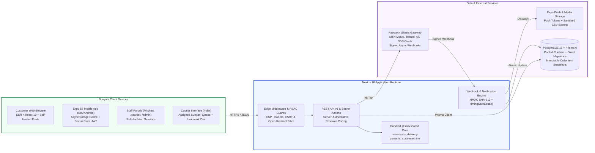

# CHAPTER FOUR
# SYSTEM IMPLEMENTATION, TESTING, AND EVALUATION

---

## 4.1 Introduction

Whereas Chapter Three established the methodological framework, requirements specifications, UML structural and behavioral models, and modular architecture of the Sika Cuisine platform, this chapter documents the translation of those engineering blueprints into an operational, production-ready multi-platform software system. In undergraduate software engineering research, implementation represents the critical empirical bridge between theoretical design and verifiable computational behavior [52]. Every architectural invariant proposed earlier—most notably server-authoritative pricing, integer pesewas financial arithmetic, deterministic Sunyani locality fee resolution, strict unidirectional kitchen state transitions, and cryptographic webhook verification—must be realized in executable code and subjected to rigorous automated verification.

This chapter details the concrete implementation of the Sika Cuisine monorepo across its three synchronized workspaces (`packages/shared`, `apps/web`, and `apps/mobile`), documents the relational persistence layer built on PostgreSQL 16 and Prisma 6, explains the operational portals serving kitchen staff, cashiers, dispatch riders, and restaurant management, and presents the empirical results of the automated unit, integration, and security test suites. Finally, the chapter evaluates the implemented system against the specific project objectives formulated in Chapter One and outlines practical operational boundaries.

---

## 4.2 Monorepo Workspace and Database Implementation

### 4.2.1 Workspace Partitioning

To prevent logic divergence between the web storefront and the native mobile application—a common failure mode in multi-platform retail systems [27]—the codebase is structured as an npm workspace monorepo (`sika-cuisine@0.1.0`) running on Node.js with strict TypeScript (`^5.7.3`) compilation across all packages:

1. **`packages/shared` (`@sika/shared`):** Serves as the single source of truth for domain mathematics, Sunyani municipal delivery zones, Zod input validation schemas, role-based access control (RBAC) policies, and the order fulfillment state machine. Both `apps/web` and `apps/mobile` import these pure TypeScript modules directly, guaranteeing identical pricing and validation rules on every client and server boundary.
2. **`apps/web` (`@sika/web`):** Implements the Next.js 16 App Router storefront, server-rendered marketing and menu pages, Server Actions, REST API v1 endpoints, Paystack webhook listener, and role-isolated operational dashboards (`/admin`, `/kitchen`, `/cashier`, `/rider`).
3. **`apps/mobile` (`@sika/mobile`):** Implements the cross-platform smartphone application using React Native (`0.88`) and Expo SDK `58`, consuming `@sika/shared` contracts via Metro workspace resolution (`metro.config.js`) while providing offline menu caching and hardware-backed token persistence.

### 4.2.2 Relational Schema and Persistence Layer

The relational data model was implemented in `prisma/schema.prisma` targeting **PostgreSQL 16** via **Prisma ORM (`^6.4.1`)** [48]. To support serverless connection pooling in production alongside direct schema migrations (`prisma migrate deploy`), the datasource configuration explicitly separates `DATABASE_URL` (pooled runtime traffic) from `DIRECT_URL` (DDL migrations).

Eighteen core relational models and six domain enums (`Role`, `FulfilmentType`, `FulfilmentStatus`, `PaymentStatus`, `PaymentMethod`, `PaymentAttemptStatus`, including `REFUND_PENDING`) enforce strict referential integrity:

* **Catalog & Option Modifiers:** `MenuCategory`, `MenuItem`, `MenuItemOptionGroup`, and `MenuItemOption` support multi-tier Ghanaian meal customization (such as spice tolerance levels, protein pairings, and extra accompaniments like fried plantain or banku) with `minSelect`, `maxSelect`, and `isRequired` cardinality constraints.
* **Immutable Order Snapshotting:** `Order`, `OrderItem`, `DeliveryAddress`, and `DeliveryZone` capture `itemNameSnapshot`, `unitPricePesewas`, `subtotalPesewas`, and `selectedOptionsSnapshot` (JSON) at checkout time alongside configurable Sunyani locality tariffs and `RestaurantSettings`. If restaurant management later adjusts prices or retires a seasonal dish, historical receipts remain unaltered.
* **Financial, Notification & Audit Traceability:** `PaymentAttempt`, `PaystackWebhookEvent` (keyed by a unique `eventId` constraint for idempotent webhook processing), `OrderStatusHistory`, `AuditLog`, `PasswordResetToken`, `PushDeviceToken`, `NotificationLog`, and `InAppNotification` maintain a permanent forensic and communication trail across web and mobile channels.

### 4.2.3 Shared Domain Core (`@sika/shared`)

Within `packages/shared/src/`, core business invariants are encapsulated into four deterministic modules:

1. **Integer Pesewas Currency Engine (`utils/currency.ts`):** Implements `formatPesewasToGhs` and `parseGhsToPesewas` using integer rounding (`Math.round` and `Math.floor`) so that monetary totals never suffer IEEE 754 binary floating-point drift [28], [29].
2. **Sunyani Locality Matrix (`utils/delivery-zones.ts`):** Maps Sunyani municipal zones—including Sunyani Central, Fiapre (CUG/UENR corridor), Berlin Top, Penkwase, New Dormaa, and Abesim—to deterministic integer pesewas delivery fees, while enforcing a mandatory `0` pesewas delivery fee whenever `FulfilmentType.COLLECTION` is selected.
3. **Order Lifecycle State Machine (`state-machine/index.ts`):** Codifies permissible forward transitions separately for `DELIVERY` (`PENDING` $\rightarrow$ `CONFIRMED` $\rightarrow$ `PREPARING` $\rightarrow$ `READY_FOR_DISPATCH` $\rightarrow$ `OUT_FOR_DELIVERY` $\rightarrow$ `DELIVERED`) and `COLLECTION` (`READY_FOR_PICKUP` $\rightarrow$ `COLLECTED`), blocking illegal cross-workflow transitions and restricting each transition to authorized staff roles.
4. **Validation & Security Helpers (`schemas/index.ts` and `contracts/`):** Enforces Ghanaian MSISDN phone validation (normalizing local `0XX...` and international `+233XX...` formats), CSV formula-injection neutralization (escaping leading `=`, `+`, `-`, and `@` characters in admin exports), and customer timeline sanitization so internal staff identifiers are never leaked to public tracking views.

---

## 4.3 Web Application Implementation (`apps/web`)

### 4.3.1 Customer Storefront and Interactive Ordering Experience

The public storefront in `apps/web/src/app/` leverages Next.js 16 Server Components for fast initial HTML delivery over Ghanaian mobile networks, paired with selective React 19 Client Components for interactive ordering:

* **Landing & Bento-Grid Menu (`page.tsx`, `menu/page.tsx`):** Dishes are presented in an editorial dark-obsidian and crimson theme (`globals.css`) utilizing self-hosted variable fonts (`Fraunces`, `Plus Jakarta Sans`, and `Syne` stored locally in `apps/web/src/fonts/`). Self-hosting eliminates render-blocking external font requests over high-latency cellular connections.
* **Cart Persistence & Flying-Tray Feedback (`context/CartContext.tsx`, `components/cart/FlyingCartAnimation.tsx`):** Selecting a dish opens `DishDetailModal`, enforcing option-group bounds before dispatching items into the cart drawer. Adding a dish triggers a Bézier-curve visual animation toward the tray badge while respecting `prefers-reduced-motion` accessibility rules.
* **Guest-to-Authenticated Checkout (`checkout/page.tsx`, `orders/[orderNumber]/page.tsx`):** Customers may place orders either as authenticated users or as guests (providing verified Ghanaian contact details and a Sunyani landmark). Post-checkout, `orders/[orderNumber]/page.tsx` renders a live fulfillment timeline synced with server state.

Figures 4.1 and 4.2 illustrate the implemented web customer storefront, interactive cart drawer, Sunyani locality checkout, and live order tracking timeline.

> **[Insert Screenshot Here: Web Storefront (`http://localhost:3000/menu`) showing dark crimson theme, Ghanaian menu cards, and open Cart Drawer]**  
> **Figure 4.1: Sika Cuisine Web Storefront, Menu Catalog, and Interactive Cart Drawer**

> **[Insert Screenshot Here: Web Checkout (`/checkout`) with Sunyani locality fee selected and/or Live Order Tracking (`/orders/[orderNumber]`)]**  
> **Figure 4.2: Sunyani Locality Checkout and Live Order Tracking Timeline**

### 4.3.2 Role-Isolated Operations Portals

Rather than exposing a monolithic back-office screen to all employees, operational access is partitioned by `Role` across dedicated Next.js routes:

* **Restaurant Management (`/admin`):** Provides full catalog CRUD (`/api/v1/admin/menu/items`), Sunyani delivery zone rate management (`/api/v1/admin/zones`), staff onboarding (`/api/v1/admin/staff`), rider assignment (`/api/v1/admin/orders/[id]/assign-rider`), manual Paystack refunds (`/api/v1/admin/orders/[id]/refund`), and integer-pesewas analytics (`/api/v1/admin/analytics`).
* **Kitchen Display System (`/kitchen`):** Restricted to `STAFF_KITCHEN` and `ADMIN` roles. Kitchen staff view paid/confirmed tickets and advance meals strictly through `PREPARING` and `READY_FOR_DISPATCH` / `READY_FOR_PICKUP`, while being blocked by RBAC from altering payment statuses or marking deliveries completed.
* **Cashier Counter (`/cashier`):** Enables front-of-house staff to confirm walk-in cash orders and log counter handovers (`COLLECTED`).
* **Courier Dispatch (`/rider`):** Restricts `DELIVERY_RIDER` accounts strictly to their assigned Sunyani delivery queue (`/api/v1/rider/orders`), displaying customer phone links and landmark instructions for final-mile handover (`OUT_FOR_DELIVERY` $\rightarrow$ `DELIVERED`).

Figures 4.3 and 4.4 present the implemented operational portals for kitchen/administrative management and courier dispatch.

> **[Insert Screenshot Here: Admin Dashboard (`/admin`) and/or Kitchen Display System (`/kitchen`) showing active order tickets and state controls]**  
> **Figure 4.3: Role-Isolated Administrative Dashboard and Kitchen Display System**

> **[Insert Screenshot Here: Courier Dispatch Portal (`/rider`) showing assigned Sunyani delivery queue and recipient landmarks]**  
> **Figure 4.4: Courier Dispatch Portal for Sunyani Final-Mile Delivery**

### 4.3.3 REST API v1 and Cryptographic Paystack Webhook

All mobile and web client mutations converge on a unified Next.js API layer under `apps/web/src/app/api/v1/` and `apps/web/src/app/api/webhooks/paystack/route.ts` [49]. Table 4.1 summarizes the primary production endpoints implemented:

**Table 4.1: Implemented Production API Route Handlers**

| Endpoint Path | Methods | Primary Consumers | Key Implementation & Security Controls |
| :--- | :--- | :--- | :--- |
| `/api/v1/auth/*` (`login`, `register`, `me`, `logout`, `reset-password`) | `POST`, `GET` | Web & Mobile | Salted password hashing, SHA-256 token digests, HttpOnly cookies (web) and Bearer JWTs (mobile). |
| `/api/v1/menu/categories`, `/api/v1/menu/items` | `GET` | Web & Mobile | Returns active categories, base prices in integer pesewas, and nested option groups. |
| `/api/v1/orders`, `/api/v1/orders/[id]/status` | `GET`, `POST`, `PATCH` | Web, Mobile, KDS, Rider | Re-fetches DB prices server-side; enforces state-machine transitions and role ownership checks. |
| `/api/v1/orders/[id]/pay`, `/api/v1/payments/verify` | `POST`, `GET` | Web & Mobile | Initializes Paystack transactions in integer pesewas; enforces double-debit retry protection. |
| `/api/v1/payments/mobile-callback` | `GET` | Expo Mobile | Validates return URLs strictly against permitted app deep-link schemes (`sikacuisine://`), blocking open redirects. |
| `/api/webhooks/paystack` | `POST` | Paystack Servers | Verifies `x-paystack-signature` using HMAC SHA-512 and `crypto.timingSafeEqual()`; logs `eventId` idempotently [50]. |
| `/api/v1/rider/orders` | `GET` | Rider Portal / App | Returns only orders assigned to the authenticated courier (`assignedRiderId`). |
| `/api/v1/admin/*` | `GET`, `POST`, `PATCH`, `DELETE` | Admin Portal | Enforces `ADMIN` session guard; provides analytics, zone config, refunds, and sanitized CSV exports. |

---

## 4.4 Cross-Platform Mobile Application Implementation (`apps/mobile`)

### 4.4.1 Native Customer Journey

The mobile client (`apps/mobile`) was built using **React Native (`0.88`)** and **Expo SDK `58`** [38], [39], organizing customer workflows into dedicated native screens under `apps/mobile/src/screens/`:

* **Discovery & Customization (`OnboardingScreen.tsx`, `HomeScreen.tsx`, `MenuScreen.tsx`, `SearchScreen.tsx`):** Presents featured Sika Cuisine delicacies, instant category filtering, and dietary search optimized for one-handed thumb navigation [40]. `DishDetailModal.tsx` mirrors the web option-group constraints using native bottom sheets.
* **Cart & Sunyani Checkout (`CartScreen.tsx`, `CheckoutScreen.tsx`):** Synchronizes live item counts via `CartContext.tsx`, resolves Sunyani locality delivery fees locally for instant preview via `@sika/shared`, and initiates server-authoritative checkout against `/api/v1/orders`.
* **Live Order Tracking & History (`OrderTrackingScreen.tsx`, `OrdersScreen.tsx`, `ProfileScreen.tsx`, `AuthScreen.tsx`):** Displays real-time fulfillment milestones via `OrderStatusTimeline.tsx`, supports one-tap reordering (`/api/v1/orders/[id]/reorder`), and registers device tokens for push updates (`/api/v1/notifications/devices`).

Figure 4.5 presents the native Expo 58 mobile application screens side-by-side.

> **[Insert 3 Mobile Screenshots Side-by-Side Here: `HomeScreen`, `DishDetailModal`/`CartScreen`, and `OrderTrackingScreen`]**  
> **Figure 4.5: Cross-Platform Mobile Application Screens (`apps/mobile`, Expo SDK 58)**

### 4.4.2 Offline Resilience, Secure Storage, and Payment Deep-Linking

Because tertiary students in Fiapre and commuters across Sunyani frequently experience intermittent 3G/4G handoffs, the mobile architecture implements three resilience mechanisms:

1. **Offline Menu Caching (`services/offline-order-cache.ts` & `AsyncStorage`):** Successfully fetched menu catalogs and recent order snapshots are persisted locally so customers can browse dishes and review past receipts even during temporary network dropouts.
2. **Hardware-Backed Credential Vault (`services/storage.ts` & `expo-secure-store`):** Authentication tokens are encrypted via iOS Keychain and Android Keystore rather than stored in plaintext `AsyncStorage`.
3. **Deep-Link Payment Return (`/api/v1/payments/mobile-callback`):** When completing Paystack Mobile Money or card authorization in an in-app browser session, Paystack redirects to the backend callback, which validates the target scheme to prevent open-redirect phishing before returning control to `OrderTrackingScreen.tsx`.

### 4.4.3 Courier Dispatch Screens

In addition to customer ordering, `apps/mobile/src/screens/rider/` provides native courier views paired with `StaffRedirectScreen.tsx`, enabling Sika Cuisine dispatch riders on motorcycles to inspect active deliveries, dial customers directly, and confirm handovers on the road without switching to a desktop browser.

---

## 4.5 System Testing and Verification

### 4.5.1 Automated Test Suite Execution

Software verification was conducted using Node.js's built-in test runner executed with `tsx` (`npx tsx --test`) across three dedicated test suites in `packages/shared/tests/` [51], [53]:
1. `shared.test.ts` — Unit tests for currency mathematics, delivery zones, Zod schemas, and state-machine transitions.
2. `api-integration.test.ts` — Integration assertions for order ownership, server-side cart recalculation, and workflow progression.
3. `security-production.test.ts` — Production security, cryptographic verification, RBAC isolation, and Ghana localization hardening tests.

Executing the full root test command (`npm test`) produced **43 deterministic test assertions with 43 passing, 0 failing, and 0 skipped**, completing in **1,665.13 ms**, as captured in Figure 4.6 and mapped across all three suites in Figure 4.8.

> **[Insert Terminal Screenshot Here: PowerShell / VS Code terminal showing `npm test` output with `tests 43 | pass 43 | fail 0 | duration_ms 1665.127`]**  
> **Figure 4.6: Terminal Execution of the Automated Verification Suite (`npm test`)**

### 4.5.2 Security and Penetration Verification Matrix

Table 4.2 details the concrete threat vectors verified within `security-production.test.ts` and `api-integration.test.ts` against OWASP API Security guidelines [32], [35], [50]:

**Table 4.2: Verified Security & Financial Integrity Test Results**

| Test Domain | Threat / Failure Mode Tested | Implemented Defense Mechanism | Observed Result |
| :--- | :--- | :--- | :--- |
| **Financial Precision** | Floating-point rounding drift (`0.1 + 0.2`) | Integer pesewas storage and `Math.round`/`Math.floor` formatting | **Pass** (5/5 currency assertions) |
| **Price Tampering** | Client sends altered item price or `0` total | Server ignores client prices; recalculates from DB `MenuItem` | **Pass** (Server overrides tampered cart) |
| **Webhook Forgery** | Spoofed `charge.success` payload without secret | HMAC SHA-512 verification via `crypto.timingSafeEqual()` | **Pass** (Rejects invalid signatures) |
| **Payment Bypass** | Advancing unpaid Paystack order to `CONFIRMED` | Payment bypass gate blocks unpaid Paystack while permitting Cash | **Pass** (Illegal transition blocked) |
| **Double Debit** | Duplicate payment initialization on active attempt | Double-debit guard inspects `PaymentAttemptStatus` before retry | **Pass** (Retry guarded) |
| **Auto-Refund Safety** | Triggering refund on unpaid or cash order | Auto-refund eligibility restricts refunds strictly to `PAID` Paystack orders | **Pass** (Unpaid orders excluded) |
| **RBAC & Workspace Isolation** | Kitchen or Rider invoking Admin/Cashier actions | Strict role-to-transition and workspace isolation matrix | **Pass** (5/5 RBAC assertions) |
| **CSV Formula Injection** | Malicious `=CMD(...)` inside customer name/note | Escapes leading `=`, `+`, `-`, `@` characters in CSV export | **Pass** (Payload neutralized) |
| **Open Redirect & Session Leak** | Malicious `returnTo` URL or User A $\rightarrow$ User B cart bleed | Allowlisted `sikacuisine://` / internal paths; session-keyed cart isolation | **Pass** (External redirects & leaks blocked) |

### 4.5.3 Localization and Operational Formatting Verification

In addition to security checks, the test suite verified Sunyani-specific operational rules:
* **Ghana Phone Normalization:** Confirmed acceptance and normalization of both local (`024...`, `055...`) and international (`+233...`) formats for SMS/courier dialing.
* **Collection Fee Invariant:** Confirmed that `FulfilmentType.COLLECTION` unconditionally resolves to `0` pesewas delivery fee regardless of any supplied locality string.
* **Customer Timeline Sanitizer:** Verified that legacy database notes are upgraded into clean customer-facing progress messages without exposing internal staff names.

---

## 4.6 Deployment Topology and Process Architecture

### 4.6.1 Production Deployment Topology

In production, the Sika Cuisine ecosystem operates across three interconnected layers: Sunyani client devices (browsers, Expo mobile apps, and staff tablets), the Next.js 16 application runtime (enforcing Edge middleware, REST API v1, `@sika/shared` domain rules, and Paystack webhook processing), and managed external services (PostgreSQL 16 via Prisma, Paystack Ghana, and Expo Push Notifications) [54], [55].

Figure 4.7 illustrates this physical and logical deployment topology. A full-width, high-resolution rendering ($1920 \times 1280\text{ px}$ at 300 DPI) is available at [docs/figures/figure_4_1_deployment_topology.png](file:///C:/Users/CLm/Desktop/Sika%20Cuisine/docs/figures/figure_4_1_deployment_topology.png).

**Figure 4.7: Production Deployment and Runtime Topology of the Sika Cuisine Platform**  
*(High-resolution 300 DPI master graphic: `docs/figures/figure_4_1_deployment_topology.png`)*

### 4.6.2 Automated Verification Coverage Matrix

Figure 4.8 maps the **43 executed and passing test assertions** across the three verification suites (`shared.test.ts`, `api-integration.test.ts`, and `security-production.test.ts`). A full-width, high-resolution rendering ($1920 \times 1240\text{ px}$ at 300 DPI) is available at [docs/figures/figure_4_2_test_verification.png](file:///C:/Users/CLm/Desktop/Sika%20Cuisine/docs/figures/figure_4_2_test_verification.png).

```mermaid
flowchart TB
    HEADER["Automated Verification Summary: 43 Executed | 43 Passed (100%) | 0 Failed | 1,665.13 ms"]

    subgraph S1 ["1. shared.test.ts (16 Unit Tests)"]
        direction TB
        U1["Integer Pesewas Currency Engine (5)"]
        U2["Sunyani Delivery Zones (2)"]
        U3["Order State Machine (6)"]
        U4["Zod Order Schemas (3)"]
    end

    subgraph S2 ["2. api-integration.test.ts (6 Integration Tests)"]
        direction TB
        I1["Ownership & Access Control (1)"]
        I2["Delivery & Pickup End-to-End Paths (3)"]
        I3["Server-Side Cart Recalculation (1)"]
        I4["Status Payload Validation (1)"]
    end

    subgraph S3 ["3. security-production.test.ts (21 Security Tests)"]
        direction TB
        P1["HMAC SHA-512 & Payment Bypass Guards (5)"]
        P2["Workspace & Role RBAC Isolation (5)"]
        P3["CSV Injection, Open Redirect & Session Isolation (6)"]
        P4["Ghana Phone Rules & Analytics Bounds (5)"]
    end

    HEADER --> S1
    HEADER --> S2
    HEADER --> S3

    style HEADER fill:#ECFDF5,stroke:#15803D,stroke-width:2px
    style S1 fill:#EFF6FF,stroke:#1D4ED8,stroke-width:2px
    style S2 fill:#FAF5FF,stroke:#7E22CE,stroke-width:2px
    style S3 fill:#FEF2F2,stroke:#B91C1C,stroke-width:2px
```

**Figure 4.8: Automated Test and Security Verification Matrix**  
*(High-resolution 300 DPI master graphic: `docs/figures/figure_4_2_test_verification.png`)*

---

## 4.7 System Evaluation and Limitations

### 4.7.1 Objective Evaluation Against Project Goals

Evaluating the implemented system against the seven specific objectives defined in Section 1.4 demonstrates complete technical alignment:
* **Architectural & Multi-Platform Parity:** Both the Next.js 16 web portal and the Expo 58 React Native mobile app operate over a single `@sika/shared` TypeScript core, eliminating duplicated pricing or state-transition code.
* **Zero-Drift Financial Accuracy:** All monetary columns and Paystack payloads operate strictly in integer pesewas, verified by deterministic unit and integration assertions.
* **Localized Sunyani Logistics:** Customers across Sunyani Central, Fiapre, Berlin Top, Penkwase, and Abesim receive transparent, upfront delivery fees, while campus riders receive structured recipient contact details and landmarks.
* **Cryptographic & Role Security:** Server-authoritative recalculation, constant-time HMAC SHA-512 webhook verification, and strict RBAC isolation across `/admin`, `/kitchen`, `/cashier`, and `/rider` eliminate the fraud and tampering vulnerabilities present in manual phone/WhatsApp ordering.

### 4.7.2 Identified Technical and Operational Limitations

In keeping with rigorous engineering transparency [56], three practical boundaries of the current implementation are acknowledged:
1. **Landmark-Based vs. Live GPS Telemetry:** Because street-level addressing across parts of Sunyani remains informal, courier routing relies on structured locality zones and descriptive landmarks rather than continuous background GPS coordinate streaming, which would otherwise drain courier smartphone batteries and mobile data bundles.
2. **External Payment Gateway Dependency:** Automated Mobile Money settlement depends on Paystack and underlying Ghanaian telecommunications USSD availability (MTN, Telecel, AT). During transient telco outages, customers can still complete orders via the Cash-on-Delivery or Cash-on-Collection workflows.
3. **Production Load & Field UAT Scope:** While all 43 automated unit, integration, and security assertions pass deterministically in the repository test runner, large-scale concurrent load benchmarking (e.g., simulating hundreds of simultaneous peak-hour student orders) and longitudinal multi-month post-deployment satisfaction surveys remain outside the immediate undergraduate build cycle and are recommended for future operational scaling.

---

## 4.8 Chapter Summary

This chapter documented the end-to-end implementation, verification, and evaluation of the Sika Cuisine multi-platform ordering and delivery tracking system:

1. **Monorepo Implementation:** Unified `packages/shared`, `apps/web`, and `apps/mobile` under strict TypeScript, backed by an 18-model PostgreSQL 16 / Prisma 6 schema with immutable `OrderItem` snapshots.
2. **Multi-Platform & Operations Delivery:** Delivered a responsive Next.js 16 customer storefront, role-isolated `/admin`, `/kitchen`, `/cashier`, and `/rider` portals, and an offline-tolerant Expo 58 React Native mobile application with SecureStore token encryption.
3. **Empirical Verification:** Executed the automated `npx tsx --test` suite across domain, API integration, and production security modules, achieving **43/43 passing assertions in 1,665.13 ms** with zero failures.
4. **Evaluation:** Confirmed full fulfillment of the project's technical objectives while transparently documenting operational scope around landmark navigation, telco USSD dependencies, and longitudinal field scaling.

Chapter Five synthesizes the overall research findings, presents formal conclusions, and offers actionable recommendations for Sika Cuisine Restaurant and future researchers.

---

## References

[52] I. Sommerville, *Software Engineering*, 10th ed. Boston, MA: Pearson, 2016.

[53] K. Beck, *Test-Driven Development: By Example*. Boston, MA: Addison-Wesley Professional, 2002.

[54] Vercel Inc., *Next.js 16 App Router Documentation: Server Actions, Route Handlers, and Edge Middleware*, San Francisco, CA: Vercel, 2026. [Online]. Available: https://nextjs.org/docs

[55] Prisma Data Inc., *Prisma ORM Reference Documentation: PostgreSQL Schema Modeling and Connection Pooling*, Berlin, Germany: Prisma, 2025. [Online]. Available: https://www.prisma.io/docs

[56] J. Brooke, "SUS: A 'quick and dirty' usability scale," in *Usability Evaluation in Industry*, P. W. Jordan, B. Thomas, B. A. Weerdmeester, and I. L. McClelland, Eds. London, U.K.: Taylor & Francis, 1996, pp. 189–194.
