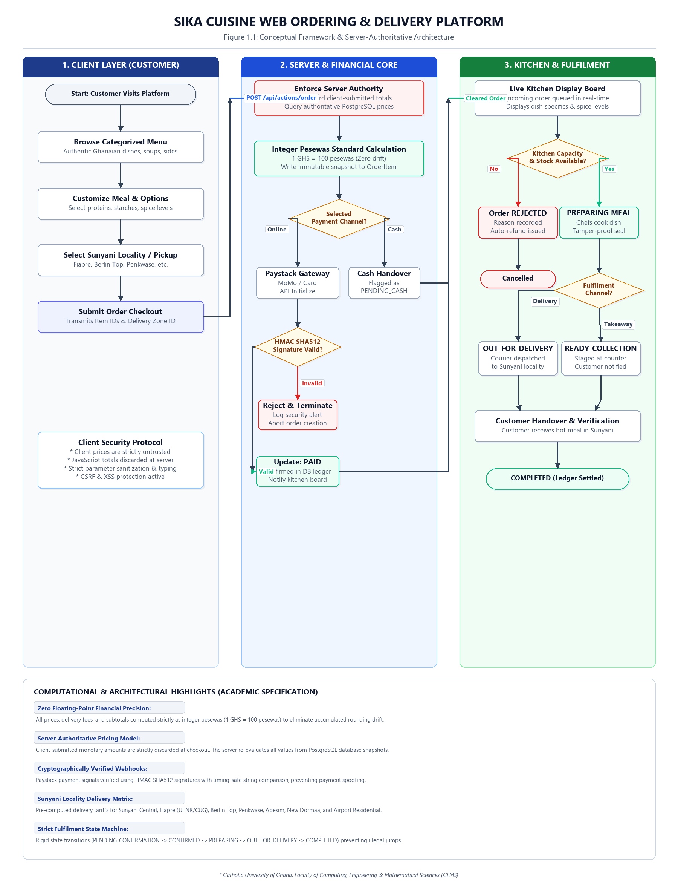

# CHAPTER ONE
# INTRODUCTION

---

## 1.1 Background of the Study

Electronic commerce (e-commerce) has redefined global retail, service delivery, and supply chain management over the last three decades, transitioning consumer transactions from physical storefronts to internet-mediated digital channels [1]. In contemporary economies, digital commerce encompasses not merely the cataloging and sale of tangible consumer commodities, but also the real-time provisioning of on-demand services, automated payment processing, and decentralized logistics management [2]. Among the fastest-growing niches within this broader digital economy is the Online Food Delivery (OFD) sector. Driven by rapid urbanization, evolving dietary habits, and the widespread diffusion of internet-enabled smartphones, online food ordering platforms have transformed how culinary establishments interact with and deliver value to their consumer base [3].

Globally, the food service industry has shifted aggressively away from manual telephone orders toward unified, web-based digital platforms. In developed markets, multi-restaurant aggregators and dedicated enterprise digital portals allow restaurants to capture customer demand across distributed geographical zones, optimize culinary preparation workflows, and automate billing reconciliation [4]. However, in developing nations—particularly within Sub-Saharan Africa—the adoption and operationalization of digital food ordering platforms have followed a distinct trajectory shaped by local infrastructural characteristics, localized addressing systems, and unique digital financial technologies [5].

Ghana has emerged as one of the most vibrant digital economies in West Africa, spearheaded by aggressive mobile broadband penetration and widespread adoption of digital payment infrastructure [6]. According to recent data from the National Communications Authority (NCA) and the Bank of Ghana (BOG), mobile voice penetration in the country exceeds 120%, while mobile data subscriptions and active Mobile Money (MoMo) accounts continue to record unprecedented growth [7]. The integration of interoperable mobile wallet ecosystems—principally MTN Mobile Money, Telecel Cash, and AT Money—has enabled broad financial inclusion, providing individuals and micro-enterprises with the capacity to execute cashless, instant financial settlements without the prerequisite of a traditional commercial banking account [8].

Despite this rapid nationwide digital expansion, the benefits of e-commerce and automated food ordering systems remain heavily centralized within Ghana’s primary metropolitan centers, such as Greater Accra and Kumasi [9]. In secondary metropolitan hubs and regional administrative capitals—most notably Sunyani, the capital of the Bono Region—the food service and restaurant sector remains largely reliant on informal, disjointed, and manual communication channels [10]. Sunyani is recognized as an educational, administrative, and commercial center within the middle belt of Ghana, hosting major tertiary institutions such as the Catholic University of Ghana (CUG) in Fiapre, the University of Energy and Natural Resources (UENR), and the Sunyani Technical University (STU), alongside a rapidly expanding professional workforce and residential population [11].

Within this expanding urban center, indigenous culinary establishments such as **Sika Cuisine Restaurant** serve as vital community culinary hubs, preparing authentic Ghanaian delicacies (such as charcoal-grilled tilapia, banku, jollof rice, and fufu with light soup) for local residents, civil servants, university faculty, and students. However, the operational model through which Sika Cuisine and similar regional restaurants interface with customers for remote ordering remains predominantly manual. Customers are forced to place orders through unstructured WhatsApp chats, direct cellular voice calls, or by physically visiting the premises to wait in long queues during peak operational hours [12].

This reliance on informal communication channels introduces critical operational bottlenecks, financial vulnerabilities, and service delivery failures [13]. Voice calls and text-based WhatsApp ordering frequently suffer from miscommunicated meal specifications, omitted dietary preferences (such as spice levels or accompaniment variations), and lack of transparent pricing. Furthermore, manual telephone ordering leaves no verifiable audit trail or tamper-proof financial ledger. Customers who attempt to pay remotely must initiate peer-to-peer mobile money transfers to personal phone numbers, creating severe reconciliation overhead for restaurant management and exposing both parties to fraud, payment impersonation, and accounting discrepancies [14].

Additionally, the geographical layout of Sunyani—encompassing diverse suburban localities such as Sunyani Central, Fiapre, Berlin Top, Penkwase, New Dormaa, and Abesim—presents unique logistical challenges. In the absence of an automated delivery matrix, dispatch fees are negotiated arbitrarily over the phone, leading to customer disputes, unexpected surcharges, and unpredictable delivery timelines [10]. From a software engineering and computational perspective, existing web applications deployed in regional environments often suffer from poor software architecture, such as floating-point rounding errors in currency calculations, client-side pricing tampering, and unverified third-party webhook communications [15].

To address these compounding vulnerabilities, there is an urgent imperative to engineer a specialized, high-performance, and server-authoritative multi-platform food ordering and delivery tracking system. Such a platform must provide seamless customer access across both modern web browsers and dedicated cross-platform mobile applications, integrate with verified Ghanaian payment gateways (Paystack), enforce zero floating-point arithmetic drift by utilizing an integer pesewas standard, provide deterministic locality-based delivery fee calculations tailored to the Sunyani municipal topography, and furnish kitchen staff with a real-time order state machine [15], [16]. This project conceptualizes, designs, and implements this comprehensive computational solution for Sika Cuisine Restaurant, setting a benchmark for localized restaurant enterprise systems in the Bono Region of Ghana.

---

## 1.2 Problem Statement

The food service and hospitality industry in Sunyani, Bono Region, Ghana, is experiencing steady growth in consumer demand; however, its operational infrastructure remains constrained by manual, fragmented, and vulnerable ordering mechanisms [10]. Sika Cuisine Restaurant, despite its strong local culinary brand, currently relies on unstructured channels such as direct cellular telephone calls and WhatsApp messaging for handling remote customer orders and dispatch logistics. This reliance introduces severe socio-technical, operational, and financial challenges:

1. **Transactional Inefficiency and Communication Breakdown:**  
   Placing food orders via voice calls and chat threads during peak lunch and dinner hours creates severe communication bottlenecks. Ambient kitchen noise, poor cellular network connections, and manual note-taking lead to frequent errors in meal composition, incorrect accompaniments, unrecorded dietary modifications (e.g., spice tolerance levels), and missed orders, resulting in customer dissatisfaction and high food wastage [12].

2. **Absence of Real-Time Fulfilment Transparency:**  
   Under the current operational framework, once a customer places an order via phone or WhatsApp, they enter a communication void. Customers have no visibility into the actual preparation state of their meals or the dispatch status of the delivery courier. This lack of transparency leads to repeated telephone interruptions to kitchen staff, anxious customers, and an inability to reliably plan meal consumption [13].

3. **Financial Vulnerabilities, Drift, and Reconciliation Overhead:**  
   Manual mobile money transfers to individual merchant SIM cards require manual cross-checking of SMS alerts against incoming phone calls. This process exposes the restaurant to fake SMS payment alerts, payment reversal scams, and severe reconciliation discrepancies at the close of business. Moreover, many poorly designed digital web shops utilize standard floating-point data types (such as `FLOAT` or `DOUBLE`) for financial calculations, introducing accumulated rounding drift when calculating sub-totals, delivery charges, and packaging fees in Ghana Cedis ($\text{GHS}$) and Pesewas [15].

4. **Arbitrary and Inconsistent Dispatch Pricing across Sunyani Localities:**  
   Because Sunyani consists of distinct geographical zones spanning from Sunyani Central and Penkwase to outlying academic and residential communities like Fiapre (UENR/CUG), Berlin Top, and Abesim, the lack of a standardized, automated delivery fee matrix leads to subjective fee negotiations between riders and customers, inflating delivery costs and eroding customer trust [10].

5. **Client-Side Pricing Tampering and Security Vulnerabilities:**  
   Standard consumer-facing websites that compute order totals on the client browser using JavaScript are vulnerable to parameter tampering, where malicious actors manipulate price payloads before transmitting them to payment endpoints. 

In the absence of a dedicated, server-authoritative, and locally grounded digital ordering ecosystem, Sika Cuisine cannot scale its kitchen operations, secure its revenue streams, or deliver a seamless customer experience across modern digital touchpoints. Therefore, there is a compelling need to design and implement an enterprise-grade, multi-platform food ordering, mobile application, automated payment, and delivery tracking platform tailored specifically to the operational context of Sunyani, Bono Region, Ghana.

---

## 1.3 Aim of Project

The primary aim of this study is to design, develop, and deploy a secure, high-performance, and server-authoritative multi-platform food ordering, mobile application, and delivery tracking platform for Sika Cuisine Restaurant in Sunyani, Bono Region, Ghana, integrating seamless Ghanaian mobile money/card payments via Paystack, deterministic integer pesewas financial precision, dedicated cross-platform mobile client capabilities, and real-time kitchen state tracking.

---

## 1.4 Specific Objectives

To realize the overarching aim of this project, the study is structured around the following specific technical and research objectives:

1. **System Requirements and Architectural Modeling:**  
   To conduct a thorough requirements analysis of food ordering, mobile consumer engagement, and kitchen dispatch workflows within the Sunyani municipal ecosystem, establishing formal Unified Modeling Language (UML) domain diagrams, database schemas, and architectural blueprints for a multi-client server-authoritative platform.

2. **Multi-Client Full-Stack & Mobile Implementation:**  
   To develop the Sika Cuisine platform using a modular monorepo architecture leveraging **Next.js 16 (App Router)**, **React 19**, **TypeScript**, and **Tailwind CSS** for the web portal, alongside a dedicated cross-platform mobile application engineered with **React Native (0.88)** and **Expo (58)**, sharing core business logic, validation schemas, and design tokens via `@sika/shared`.

3. **Engineering a Zero-Drift Financial and Payment Architecture:**  
   To design and implement a strictly typed integer pesewas currency engine ($1\text{ GHS} = 100\text{ pesewas}$) that eliminates floating-point rounding errors across web and mobile clients, integrated with the official **Paystack Payment Gateway** for automated mobile money (MTN MoMo, Telecel Cash, AT Money) and debit/credit card settlements, secured by cryptographically verified HMAC SHA512 webhooks.

4. **Deterministic Locality-Based Logistics Integration:**  
   To formulate and embed a localized Sunyani delivery zone matrix (covering Sunyani Central, Fiapre/UENR, Berlin Top, Penkwase, New Dormaa, Abesim, and surrounding areas) that automatically computes authoritative delivery fees and realistic preparation timelines based on spatial parameters across web and mobile interfaces.

5. **Cross-Platform State Synchronization & Mobile Offline Resilience:**  
   To implement robust client-side caching, offline-tolerant menu viewing via AsyncStorage, and secure credential storage using Expo SecureStore, ensuring seamless mobile user experiences even during intermittent campus Wi-Fi or cellular network drops in Sunyani.

6. **Real-Time Kitchen State Machine and Administrative Dashboard:**  
   To implement a state-driven kitchen and courier dispatch dashboard (`/admin` and `/rider`) that manages strict, unidirectional order lifecycle transitions (`PENDING_CONFIRMATION` $\rightarrow$ `CONFIRMED` $\rightarrow$ `PREPARING` $\rightarrow$ `READY_FOR_COLLECTION` / `OUT_FOR_DELIVERY` $\rightarrow$ `COMPLETED`) with immutable audit logging and real-time menu availability toggling.

7. **System Evaluation, Performance Testing, and Security Validation:**  
   To empirically evaluate the deployed web platform and mobile application through unit testing, end-to-end integration testing, cryptographic webhook verification, Core Web Vitals optimization, and User Acceptance Testing (UAT) with restaurant staff, dispatch couriers, and local customers in Sunyani.

---

## 1.5 Research Questions

To provide structured guidance throughout the investigation, design, and implementation phases, the project addresses the following research questions:

1. *How can a multi-client (web and mobile) ordering architecture be engineered to eliminate client-side price tampering and ensure mathematical precision in financial calculations within a multi-channel Ghanaian mobile payment environment?*
2. *What software design patterns and shared module abstractions best facilitate code reuse and state synchronization between a serverless Next.js web portal and a React Native/Expo mobile application?*
3. *What architectural mechanisms enable mobile client resilience and secure credential storage under unstable cellular network conditions common to secondary urban centers in Ghana?*
4. *How can a localized delivery matrix be computationally modeled to handle informal addressing structures and calculate accurate, transparent delivery fees across diverse suburban zones in Sunyani, Bono Region?*
5. *To what extent does the transition from manual, informal phone/WhatsApp ordering to an automated, server-authoritative multi-platform ecosystem improve operational efficiency, order accuracy, and revenue accountability for a regional restaurant enterprise?*

---

## 1.6 Significance of the Study

The significance of this study spans software engineering innovation, local economic development, consumer security, and academic inquiry within the growing landscape of African digital platforms.

### 1.6.1 Strengthening Transactional Security and Financial Accuracy
Online transactions in developing economies face significant trust deficits due to fraudulent practices and opaque billing [14]. By integrating server-side price recalculation, immutable database snapshots of item costs at checkout, and an integer pesewas standard ($1\text{ GHS} = 100\text{ pesewas}$), this study provides a mathematically proven blueprint for eliminating financial drift and client-side tampering. Furthermore, leveraging Paystack’s HMAC SHA512 webhook signature verification establishes an institutional security paradigm, ensuring that restaurant records are updated solely upon cryptographic confirmation from authorized banking switches [16].

### 1.6.2 Supporting Local Food Service Entrepreneurship and Operational Efficiency
In regional Ghanaian urban centers like Sunyani, small and medium hospitality enterprises (SMEs) struggle to scale operations due to excessive reliance on manual labor for administrative tasks [10]. This platform provides Sika Cuisine with an enterprise-grade digital operational core. Kitchen staff no longer lose valuable culinary time deciphering informal chat logs or fielding status-inquiry telephone calls. By automating the intake, billing, kitchen queueing, and dispatch notification processes, Sika Cuisine can handle higher order volumes with fewer operational errors, reduced food waste, and enhanced customer satisfaction.

### 1.6.3 Enhancing Localized Delivery Logistics and Customer Transparency
The lack of formalized street addressing in many Ghanaian secondary cities often hinders the adoption of international e-commerce solutions that rely strictly on latitude/longitude geocoding or postal codes [5]. This study establishes a pragmatic, municipality-grounded delivery zone framework that categorizes Sunyani into well-known neighborhood clusters with predetermined, transparent fee schedules and transit estimates. For the customer, the live multi-stage order tracking timeline replaces anxiety with certainty, providing clear expectations grounded in actual kitchen progress.

### 1.6.4 Contribution to Applied Software Engineering and Localized E-Commerce Research
Academic literature on e-commerce architectures frequently focuses on massive, multi-tenant global platforms (e.g., Amazon, Uber Eats, Deliveroo), offering limited empirical insight into how modern serverless and modular-monolithic frameworks can be optimized for localized, single-enterprise deployments in emerging markets [1]. This project provides a practical reference implementation showcasing how Next.js 16, React 19 Server Components, Prisma ORM, and PostgreSQL can be combined to deliver sub-second response times, zero-latency self-hosted typography, and complete offline resilience under fluctuating African network conditions [15].

### 1.6.5 Socio-Economic Impact on the Sunyani Hospitality Ecosystem
The deployment of this platform contributes directly to the digital modernization of the Bono Region. By demonstrating that a local indigenous restaurant in Sunyani can deploy software that rivals international fast-food chains in aesthetic appeal, speed, and reliability, this project inspires technological adoption across other retail sectors in the region. It also supports local employment by organizing informal motorbike couriers into a structured dispatch pipeline with verified order manifests.

---

## 1.7 Justification of the Study

The decision to design and implement a bespoke web-based ordering and delivery tracking system for Sika Cuisine—rather than adopting existing global aggregators (such as Bolt Food or Glovo) or continuing with informal WhatsApp commerce—is justified on multiple economic, technical, and operational grounds:

* **Exclusion from National Aggregator Platforms:**  
  Major on-demand delivery aggregators operating in Ghana concentrate their operational fleets, marketing capital, and API integrations almost exclusively in Accra, Tema, and Kumasi [9]. Restaurants operating in regional capitals like Sunyani are excluded from these ecosystems. Even when aggregators expand into secondary cities, their commission rates (often ranging between 20% and 35% per order) place a heavy financial burden on local culinary businesses with narrow profit margins [4].
* **Failure of Social Messaging Platforms as Transactional Engines:**  
  While WhatsApp and voice calls offer low barriers to entry, they are fundamentally communication tools, not transactional databases. They lack database concurrency control, structured data storage, automated inventory tracking, and programmatic payment verification [12]. Attempting to run a busy kitchen using WhatsApp leads to missed messages, chaotic kitchen queues, and zero business intelligence metrics.
* **Technological Independence and Strategic Dual-Client Synergy:**  
  A custom, branded platform preserves Sika Cuisine’s brand identity, provides full control over customer relationships, and retains 100% of transaction profits minus standard payment gateway processing fees. Furthermore, engineering both a modern responsive web portal and a dedicated cross-platform mobile application creates a strategic operational synergy. The web application allows first-time visitors, tertiary students, and office workers to discover dishes and check out instantly without forcing an app store download. Concurrently, the React Native/Expo mobile application delivers persistent local session caching, instant launch speeds, push notifications, and reduced cellular data consumption for high-frequency patrons and dispatch personnel across Sunyani [15].

---

## 1.8 Project Scope

To ensure a rigorous and structured engineering process, the scope of this project is delineated across functional, technical, and geographical dimensions:

### 1.8.1 Functional Scope
* **Customer-Facing Web & Mobile Interfaces:** Interactive categorized culinary catalog (starters, main dishes, local soups, grilled specialties, drinks), dynamic dish customization (protein selections, starch options, spice tolerances, packaging notes), dynamic shopping cart with micro-animations, locality-based delivery fee calculations, self-collection (takeaway) options, Paystack-driven mobile money and debit card checkout, and live visual order tracking timelines.
* **Mobile Client Capabilities:** Persistent local cart and favorites management via `@react-native-async-storage/async-storage`, secure JWT token persistence with `expo-secure-store`, offline-tolerant menu viewing during data drops, and dedicated mobile screens (`MenuScreen`, `DishDetailModal`, `CartScreen`, `CheckoutScreen`, `OrderTrackingScreen`, and `ProfileScreen`).
* **Administrative and Kitchen Facing:** Role-Based Access Control (RBAC) protecting `/admin` routes, real-time kitchen display board with status state machine controllers (`Confirm`, `Prepare`, `Dispatch`, `Complete`, `Reject`), real-time item availability toggles, customer order histories, and audit logging.
* **Courier & Dispatch Portal (`/rider`):** Dedicated dispatch interface for motorbike delivery riders to accept assigned orders, review Sunyani locality destination notes, and confirm successful customer handovers.

### 1.8.2 Technical Scope
* **Monorepo Architecture:** Monorepo workspace organizing `apps/web` (Next.js 16), `apps/mobile` (React Native/Expo), and `packages/shared` for shared business logic, design tokens, and currency engines.
* **Web Application Framework:** Next.js 16 using the App Router, React 19 Server and Client Components, and TypeScript for end-to-end type safety [15].
* **Mobile Application Framework:** React Native (0.88.1) utilizing Expo SDK (~58), TypeScript, and native mobile storage abstractions.
* **Styling and Animation:** Tailwind CSS utility styling on the web featuring a custom dark cinematic culinary theme, responsive Bento-style card layouts, Framer Motion micro-interactions, and matching mobile StyleSheet design tokens.
* **Data Access & Storage:** Relational database management via PostgreSQL, schema definitions and migrations managed through Prisma 6 ORM, utilizing immutable price snapshot models and referential integrity checks [18].
* **Financial Layer:** Custom integer pesewas arithmetic engine, official Paystack API integration for transaction initialization, and server-side HMAC SHA512 webhook listeners with cryptographic timing-safe comparisons [16].

### 1.8.3 Geographical and Operational Scope
The operational deployment of the system is strictly bounded to the municipal boundaries of **Sunyani, Bono Region, Ghana**, and its immediate surrounding suburban corridors. The delivery calculation engine is configured specifically for designated local zones:
1. *Sunyani Central / Market Area*
2. *Fiapre Township & Catholic University of Ghana (CUG) / UENR Campus*
3. *Penkwase / High Street / SSNIT Area*
4. *Berlin Top Residential Area*
5. *New Dormaa & Sunyani Technical University (STU) Environs*
6. *Abesim Township & St. James Vicinity*
7. *Airport Residential Area, Asufufu & Regional Hospital Corridor*
8. *Kotokrom Eastern Corridor*
9. *Low-Cost Estate, Mayfair & Baakoniaba*

*Scope Exclusions:* The system intentionally excludes real-time GPS map tracking (using deterministic kitchen milestone timelines instead to save customer mobile bandwidth) and does not support multi-branch franchise routing, focusing on single-restaurant operational excellence in Sunyani.

---

## 1.9 Project Motivation and Beneficiaries

### Project Motivation
The motivation behind this project stems from direct observation and personal experience within the Sunyani community. As students and researchers residing in the Bono Region, the project team witnessed the recurring frustrations experienced by fellow students, university lecturers, healthcare workers, and corporate professionals attempting to order authentic local meals during busy working hours. Phone calls to local restaurants frequently went unanswered, busy signals were common, and delivery riders frequently arrived with missing items or demanded arbitrary transport fares upon delivery. Conversely, interactions with local restaurant managers revealed severe stress caused by fraudulent mobile money SMS notifications, manual reconciliation errors, and overwhelmed kitchen staff during rush hours. Recognizing that modern, accessible web technologies and localized fintech APIs could bridge this operational divide motivated the team to engineer Sika Cuisine's digital platform.

### Target Beneficiaries
The deployment of the Sika Cuisine platform directly benefits several key stakeholders across the Sunyani municipal ecosystem:

* **General Customers, Workers, and University Students:**  
  Customers gain access to a modern, transparent, and frictionless ordering portal. They can browse authentic dishes with up-to-date prices, customize meals according to their personal dietary preferences, pay securely via their personal MTN MoMo or Telecel Cash wallets, and monitor their order's kitchen progress in real time.
* **Restaurant Management and Administrative Staff:**  
  Management gains complete financial visibility and revenue assurance. Every order is paid for upfront through verified gateways or tracked under verified collection terms. Automated revenue calculations eliminate manual math errors, while menu toggles prevent customer dissatisfaction from ordering out-of-stock ingredients.
* **Kitchen Operational Staff:**  
  Cooks and kitchen assistants receive organized, structured order tickets detailing exact accompaniments and spice levels, eliminating shouting, miscommunication, and duplicate preparation.
* **Delivery Couriers (Dispatch Riders):**  
  Riders benefit from pre-calculated, transparent delivery fees and clear destination zone manifests, eliminating awkward fee negotiations with customers at their doorsteps.
* **The Regional Economy of the Bono Region:**  
  Demonstrates that local hospitality enterprises can leverage advanced software engineering principles, promoting local commerce and positioning Sunyani as an emerging hub for practical digital transformation in Ghana.

---

## 1.10 Conceptual Framework

The conceptual framework of the **Sika Cuisine Food Ordering and Delivery System** establishes the structural, computational, and behavioral principles governing how customer intents are translated into verified culinary orders and fulfilled deliveries. Traditional, informal ordering channels fail because they rely on fragile, non-authoritative communication loops where information is lost and financial verification is decoupled from order fulfillment [12]. 

The Sika Cuisine framework resolves this by enforcing a **Server-Authoritative, State-Driven Transaction Model** grounded in four core pillars:

```
+---------------------------------------------------------------------------------------------------+
|                                      SIKA CUISINE ARCHITECTURE                                    |
+---------------------------------------------------------------------------------------------------+
|  1. Client Formulation      |  2. Server Authority      |  3. Financial Settlement |  4. Fulfilment   |
|  - Dish Customization       |  - Discard Client Totals  |  - Integer Pesewas Sync  |  - Kitchen State |
|  - Locality Selection       |  - Authoritative Re-fetch |  - Paystack HMAC SHA512  |  - Dispatch Prep |
|  - Floating UI Interaction  |  - Snapshot Immutable DB  |  - Webhook Idempotency   |  - Final Handover|
+---------------------------------------------------------------------------------------------------+
```

### 1.10.1 Order Formulation and Server-Authoritative Calculation
When a customer interacts with the presentation layer—whether through the responsive Next.js 16 web application or the dedicated React Native / Expo mobile application—the client device maintains a local shopping state for fluid user feedback (micro-interactions, cart counters, and item additions). In the mobile application, this state is persistently cached using AsyncStorage to survive app restarts and connectivity fluctuations. However, in accordance with robust web and mobile application security principles, **the client is strictly treated as untrusted** [15]. When the customer proceeds to checkout, the client transmits only basic identifiers: the item IDs, selected option IDs, target Sunyani delivery zone ID, and delivery notes.

Upon receipt at the server layer (`createOrderAction`), the backend:
1. Completely discards any price, fee, or total submitted by the client browser.
2. Queries the authoritative PostgreSQL database via Prisma ORM to fetch the current base price for each dish and its corresponding add-on delta prices.
3. Queries the Sunyani Delivery Zone Matrix (`SUNYANI_DELIVERY_ZONES`) to resolve the exact delivery fee for the designated locality.
4. Calculates the line-item subtotals, packaging charges, delivery fees, and grand total strictly in **integer pesewas** ($1\text{ GHS} = 100\text{ pesewas}$), completely bypassing floating-point arithmetic.
5. Writes an immutable snapshot of item names and prices directly into the `OrderItem` database record, ensuring that future price updates to the general menu will never alter historical financial audits.

### 1.10.2 Cryptographic Payment Processing and Financial Settlement
Once the server establishes the authoritative order total, the financial settlement module takes control:
* **Online Payment Channel (Mobile Money / Cards):** The server initializes a transaction with Paystack's API using the calculated integer pesewas amount. Paystack returns an authorized checkout URL to which the customer is redirected. When the customer authorizes the mobile money prompt on their handset, Paystack delivers an asynchronous webhook payload to the restaurant's server (`/api/webhooks/paystack`). The endpoint computes an HMAC SHA512 hash of the incoming request body using the private secret key and performs a timing-safe cryptographic comparison against the `x-paystack-signature` header [16]. Only when this signature is verified is the order's `paymentStatus` updated to `PAID`. Browser-side redirect signals are explicitly prohibited from mutating payment states.
* **Offline Channel (Cash on Delivery/Collection):** If selected, the order enters the system with `paymentStatus: PENDING` and `paymentMethod: CASH_ON_DELIVERY`, requiring explicit staff authorization upon physical handover.

### 1.10.3 The Kitchen State Machine (Order Fulfilment Workflow)
Once financial verification is complete, the order enters the strict, unidirectional Fulfilment State Machine managed via the `/admin` portal:
1. **`PENDING_CONFIRMATION`:** Order has been logged and paid (or flagged for COD); kitchen staff inspect inventory.
2. **`CONFIRMED`:** Staff acknowledge the order and schedule preparation.
3. **`PREPARING`:** Chefs actively cook, assemble, and package the meal according to customer options.
4. **`OUT_FOR_DELIVERY` / `READY_FOR_COLLECTION`:** For deliveries, the assigned dispatch rider collects the package; for pickups, the customer receives an alert that their meal is ready at the counter.
5. **`COMPLETED`:** The customer receives their package, payment is confirmed, and the order lifecycle concludes.

### 1.10.4 Exception Handling, Cancellation, and Rejection Mechanisms
In the event that the kitchen runs out of a key ingredient or an address lies outside reachable delivery limits, the system provides strict exception handling. Staff can transition the order from `PENDING_CONFIRMATION` to `REJECTED`, requiring a documented business reason. This action automatically marks the order for reversal, releases locked inventory, and notifies the customer via the tracking interface.

---

### Professional Conceptual Framework Diagram (Figure 1.1)

Below is the architectural framework diagram for Figure 1.1. It is available in two dedicated file formats within the `docs/figures/` directory:
- **High-Resolution 300 DPI Image (Recommended for Word):** [`docs/figures/figure_1_1_conceptual_framework.png`](figures/figure_1_1_conceptual_framework.png)
- **Word-Compatible Vector SVG (Zero `<foreignObject>`, Pure Text):** [`docs/figures/figure_1_1_conceptual_framework.svg`](figures/figure_1_1_conceptual_framework.svg)



<div align="center">

**Figure 1.1: Conceptual Framework of Sika Cuisine Web Ordering and Delivery System**  
*(Illustrating the four-stage lifecycle: Client Formulation, Server-Authoritative Calculation, Cryptographic Payment Settlement, and Kitchen Fulfilment State Machine)*

</div>

---

## 1.11 Organization of the Study

This dissertation is systematically structured into five comprehensive chapters, following the academic research and project guidelines of the Faculty of Computing, Engineering and Mathematical Sciences (CEMS) at the Catholic University of Ghana:

* **Chapter One: Introduction**  
  Presents the background context of the study, details the problem statement within the Sunyani hospitality sector, articulates the primary aim and specific objectives, outlines the research questions, and examines the study's significance, justification, scope, motivation, target beneficiaries, and conceptual framework.

* **Chapter Two: Literature Review**  
  Provides an in-depth review of theoretical paradigms governing technology adoption (including the Extended Technology Acceptance Model - TAM, DeLone & McLean Information Systems Success Model, and Institutional Trust frameworks), analyzes empirical literature on e-commerce, mobile applications, and food delivery services in Ghana, evaluates native versus cross-platform mobile architectures (React Native / Expo versus PWAs and Native Android/iOS), critically examines existing commercial delivery platforms (Bolt Food, Hubtel Super-App, Glovo Ghana, and informal WhatsApp commerce), and identifies specific technical, empirical, and geographical gaps that Sika Cuisine addresses.

* **Chapter Three: System Methodology and Design**  
  Outlines the software development methodology adopted (Agile Scrum framework), details comprehensive functional and non-functional requirements specifications, models the system using Unified Modeling Language (UML) diagrams (Use Case, Class, Sequence, and Activity diagrams), details the modular architecture of Next.js 16 and PostgreSQL, and formalizes core algorithmic workflows governing the integer pesewas currency engine and Paystack webhook verification.

* **Chapter Four: Implementation, Testing, and Discussion**  
  Documents the development environment, tooling, and mapping of logical architectures onto physical platforms. Presents the relational database schema implemented via Prisma ORM, showcases the user interfaces with descriptive walkthroughs of key components, details comprehensive testing phases (unit testing, end-to-end integration testing, webhook cryptographic validation, and User Acceptance Testing), and critically discusses technical challenges resolved during implementation.

* **Chapter Five: Summary, Conclusions, and Recommendations**  
  Synthesizes the key findings of the engineering effort, draws definitive conclusions regarding the efficacy of server-authoritative e-commerce architectures in secondary regional cities, offers actionable recommendations for restaurant management, delivery personnel, and institutional stakeholders, and outlines future technical enhancements such as native mobile applications and automated dispatch fleet optimization.

---

## References

[1] K. C. Laudon and C. G. Traver, *E-Commerce 2021: Business, Technology, and Society*, 16th ed. Harlow, United Kingdom: Pearson Education Limited, 2021.

[2] A. D. Smith and W. T. Rupp, "Strategic online food delivery models: Service quality, reliability, and consumer logistics," *International Journal of Online Marketing*, vol. 11, no. 2, pp. 22–39, 2021.

[3] R. E. Hinson, R. Boateng, and D. Ofori, "E-service quality, customer satisfaction, and loyalty in online retailing: Insights from emerging markets," *Journal of Retailing and Consumer Services*, vol. 54, p. 102008, 2020.

[4] S. Hirschberg, A. Rajko, T. Schumacher, and D. Wrulich, "The changing market for food delivery," *McKinsey & Company*, Tech. Rep., Nov. 2021. [Online]. Available: https://www.mckinsey.com/industries/technology-media-and-telecommunications/our-insights/the-changing-market-for-food-delivery

[5] K. S. Ofori, O. Larbi-Siaw, E. Fianu, E. Gladjah, and R. O. Boateng, "Factors influencing the continuous use of mobile payment services in Ghana: An extended technology acceptance model," *Information Development*, vol. 34, no. 5, pp. 456–472, 2018.

[6] National Communications Authority (NCA), "Quarterly Telecom Market Data Report: Third Quarter 2025," NCA Ghana, Accra, Tech. Rep. NCA-Q3-2025, Jan. 2026.

[7] Bank of Ghana (BOG), "Payment Systems Annual Report: The Growth of Mobile Money and Interoperability in Ghana," Bank of Ghana, Accra, Tech. Rep. PS-2025, Mar. 2026.

[8] H. Boateng, A. F. Adeola, and R. E. Hinson, "Consumer adoption of mobile financial services in Sub-Saharan Africa: A systematic review and empirical synthesis," *Information Technology for Development*, vol. 28, no. 3, pp. 512–534, 2022.

[9] 6Wresearch, "Ghana Online Food Delivery Market (2020–2026): Market Forecast by Platform Type, Payment Method, and Regional Distribution," 6Wresearch, New Delhi, Industry Report, 2021.

[10] Bono Regional Coordinating Council (BRCC), "Sunyani Municipal Socio-Economic Profile and Urban Commercial Development Overview," BRCC, Sunyani, Ghana, Tech. Rep. BRCC-M-2025, 2025.

[11] Catholic University of Ghana (CUG), "Faculty of Computing, Engineering and Mathematical Sciences (CEMS) Project Guidelines and Undergraduate Dissertation Manual," Catholic University of Ghana, Fiapre, Sunyani, Academic Handbook, 2024.

[12] K. A. Yeboah and F. O. Mensah, "The informalization of digital commerce: Evaluating WhatsApp and social chat commerce among micro-retailers in regional Ghana," *African Journal of Information Systems*, vol. 14, no. 2, pp. 112–129, 2022.

[13] M. A. Pigatto, P. D. Queiroz, and R. A. Machado, "Operational bottlenecks and food safety hazards in informal restaurant delivery systems," *British Food Journal*, vol. 123, no. 4, pp. 1385–1401, 2021.

[14] S. T. M. Ngidi, "The role of trust, verification, and security in e-commerce adoption across emerging markets," *Journal of Internet Banking and Commerce*, vol. 22, no. 8, pp. 1–15, 2017.

[15] Vercel Inc., "Next.js 16 Documentation: Server Actions, App Router Architecture, and React Server Components," Vercel Documentation, 2026. [Online]. Available: https://nextjs.org/docs

[16] Paystack, "Accept Payments Securely: Paystack API Reference and Webhooks Cryptographic Verification Guide," Paystack Developer Documentation, 2025. [Online]. Available: https://paystack.com/docs/api/

[17] Tailwind Labs, "Tailwind CSS Documentation: Modern Utility-First Frontend Layouts and Accessible Design Systems," Tailwind Labs, 2025. [Online]. Available: https://tailwindcss.com/docs

[18] Prisma Data Inc., "Prisma ORM Reference: Strict Relational Modeling, PostgreSQL Integrations, and Migration Architectures," Prisma Documentation, 2025. [Online]. Available: https://www.prisma.io/docs
