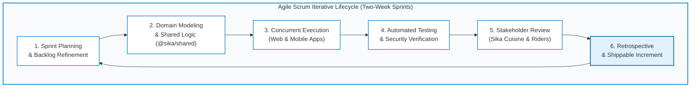
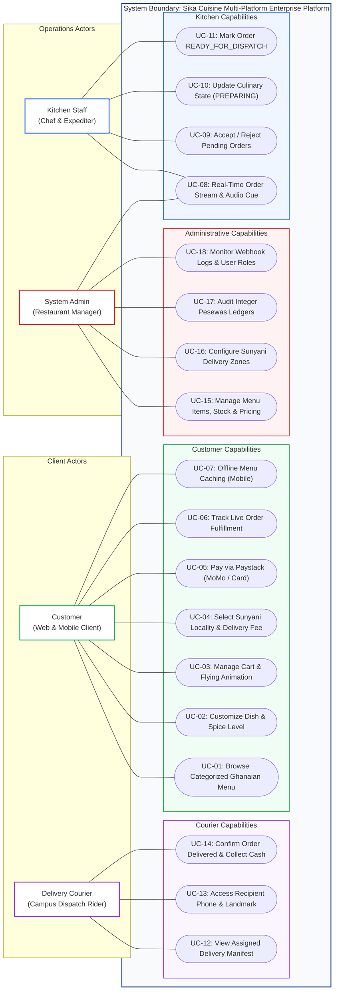
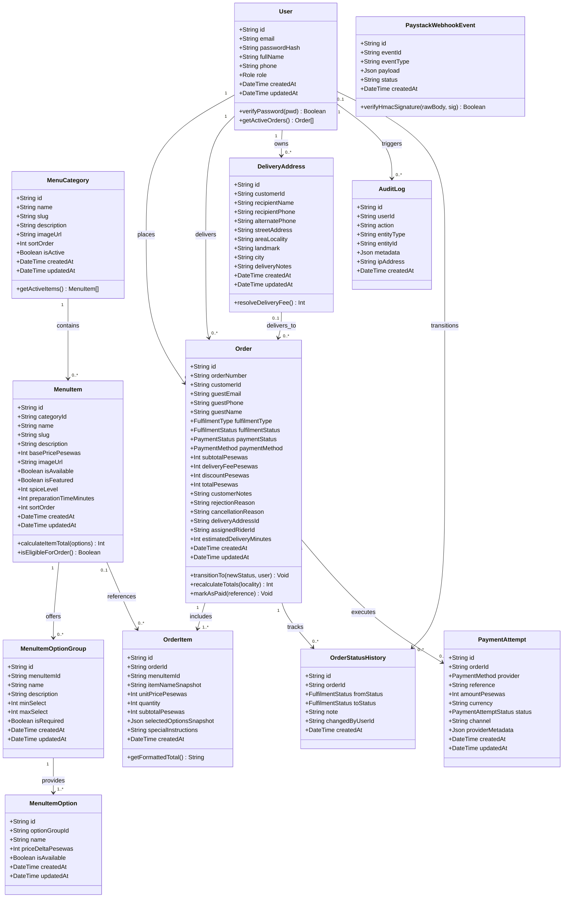
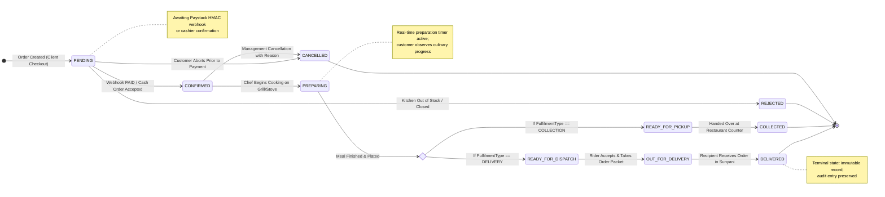
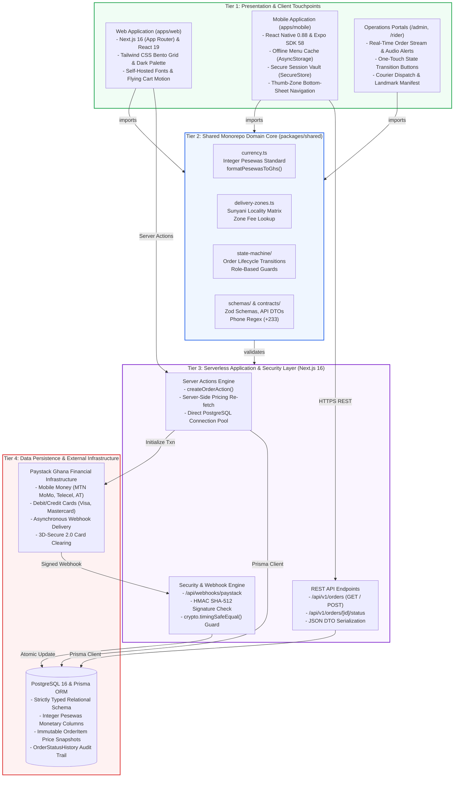

# CHAPTER THREE
# METHODOLOGY AND SYSTEM DESIGN

---

## 3.1 Introduction

Software engineering in modern enterprise environments demands an empirical, rigorous, and repeatable methodology to translate human operational requirements into dependable computational systems [45]. For localized retail and hospitality establishments operating in developing secondary economies, software design cannot proceed as an abstract exercise in standard programming; it must be grounded intimately within the infrastructural, geographical, and technological realities of its operational environment. Sika Cuisine Restaurant, situated in Sunyani, Bono Region, Ghana, represents an authentic indigenous food service enterprise transitioning from disjointed manual touchpoints (unstructured phone conversations, peer-to-peer WhatsApp chats, and paper order chits) to a unified, multi-platform digital ordering, automated payment settlement, and live kitchen dispatch ecosystem.

This chapter establishes the engineering methodology, requirements specifications, architectural blueprints, Unified Modeling Language (UML) structural and behavioral models, and algorithmic procedures governing the development of the Sika Cuisine platform. Specifically, this chapter articulates:
1. The adoption and contextual justification of the **Agile Scrum development methodology**, delineating sprint iterations across the monorepo architecture.
2. The domain-grounded **requirements engineering process**, detailing the functional capabilities required by customers, kitchen culinarians, campus delivery riders, and managerial administrators.
3. The formal **Unified Modeling Language (UML 2.5) models** [46] representing structural static topologies and dynamic event-driven interactions.
4. The **system architecture**, illustrating the interaction between the Next.js 16 App Router web portal, the React Native / Expo 58 cross-platform mobile application, the shared TypeScript domain core (`@sika/shared`), the PostgreSQL relational persistence layer, and the external Paystack Ghana payment infrastructure [47].
5. The **algorithmic mechanics and state machine invariants** that enforce server-authoritative pricing, zero floating-point arithmetic drift through an integer pesewas standard, and cryptographic webhook authentication.

---

## 3.2 Research and Development Methodology

### 3.2.1 Adoption of the Agile Scrum Framework

To engineer a resilient multi-platform system across both web and mobile client targets while continuously accommodating the feedback of local stakeholders in Sunyani, this project adopted the **Agile Scrum framework** [45]. Traditional sequential software engineering methodologies—such as the classic Waterfall model—presuppose complete, immutable upfront requirements and defer integration testing until the final phases of development. In the context of a restaurant enterprise deploying concurrently to desktop browsers, mobile web, and native Android/iOS mobile environments with external payment gateway dependencies, Waterfall introduces severe project risks: late-stage integration defects, inability to adjust to localized campus delivery logistics, and delayed user validation.

In contrast, Agile Scrum organizes system development into time-boxed, iterative cycles termed *Sprints*, typically lasting two weeks [45]. Each sprint yields an increment of potentially shippable software, encompassing cross-functional activities: domain analysis, architectural design, component implementation, automated unit and integration testing, and empirical stakeholder review. Figure 3.1 contextualizes this iterative paradigm across the project's development lifecycle.



### 3.2.2 Justification of Agile Scrum for Sika Cuisine

The selection of Agile Scrum over alternative software engineering methodologies was guided by four technical imperatives inherent to the Sika Cuisine operational domain:

1. **Concurrent Multi-Platform Development:**  
   The project encompasses a Next.js 16 web application and an Expo 58 React Native mobile application powered by a shared monorepo core. Scrum permitted parallel feature parity: as menu navigation and cart logic were codified in `packages/shared`, they were simultaneously consumed and tested on web viewports and mobile touchscreens within the same sprint cycle.

2. **Empirical Grounding in Sunyani's Urban Layout:**  
   The delivery topology of Sunyani—incorporating institutional campuses such as Catholic University of Ghana (CUG) in Fiapre, University of Energy and Natural Resources (UENR), and residential nodes such as Berlin Top and Penkwase—demanded empirical calibration [10]. Engaging local dispatch couriers at sprint review sessions enabled rapid refinement of the delivery zone matrix and courier dispatch interfaces.

3. **High-Stakes Financial Integration with Paystack:**  
   Integrating digital financial transactions (MTN Mobile Money, Telecel Cash, and bank cards) required rigorous security verifications. An incremental approach allowed payment initialization, USSD push flows, and cryptographic HMAC SHA-512 webhook validation to be isolated, thoroughly tested with simulated network dropouts, and validated prior to building dependent order-tracking workflows [16], [32].

4. **Continuous Feedback from Non-Technical Culinary Staff:**  
   Kitchen personnel operate in fast-paced, high-heat physical environments. Presenting early interactive prototypes of the Kitchen Display System (KDS) during sprint reviews ensured that button hit targets, status color coding, and audio alerts were optimized for kitchen expediting without cognitive friction.

### 3.2.3 Sprint Decomposition and Project Lifecycle

The implementation of the Sika Cuisine multi-platform system was partitioned across six disciplined sprints following an initial Sprint 0 setup:

* **Sprint 0: Architectural Inception & Monorepo Configuration (Week 1–2):**  
  Establishment of the npm workspace monorepo structure (`apps/web`, `apps/mobile`, `packages/shared`). Configuration of TypeScript strict mode, ESLint, Prettier, Prisma ORM, and PostgreSQL containerization. Definition of shared domain entities and base configuration tokens.

* **Sprint 1: Relational Persistence & Core Domain Logic (Week 3–4):**  
  Codification of the PostgreSQL database schema in Prisma. Implementation of the `@sika/shared` domain library, containing the integer pesewas mathematical engine (`currency.ts`), the Sunyani municipal delivery matrix (`delivery-zones.ts`), and the deterministic order state machine (`state-machine/index.ts`). Automated unit testing of financial rounding invariants with Jest.

* **Sprint 2: Web Presentation & Server-Authoritative Ordering (Week 5–6):**  
  Implementation of the public web application using Next.js 16 App Router and React 19. Construction of the responsive bento-grid menu display, item detail modal with spice and option configurators, client-side cart context, and animated flying-cart micro-interaction. Implementation of server-authoritative Next.js Server Actions for checkout validation.

* **Sprint 3: Native Mobile Application Development (Week 7–8):**  
  Engineering of the mobile application using React Native 0.88 and Expo SDK 58. Implementation of thumb-zone navigation, bottom-sheet customization dialogs, offline menu caching via `@react-native-async-storage/async-storage`, and secure session storage using `expo-secure-store`. Integration of shared contracts from `@sika/shared`.

* **Sprint 4: Financial Gateway & Webhook Infrastructure (Week 9–10):**  
  Integration of Paystack Ghana API for Mobile Money (MTN, Telecel, AT) and card clearing. Implementation of the `/api/webhooks/paystack` route handler, secured with cryptographic HMAC SHA-512 signature validation and timing-safe comparisons. Construction of the idempotent transaction ledger (`PaystackWebhookEvent`).

* **Sprint 5: Operations Portals & Real-Time Fulfilment (Week 11–12):**  
  Construction of the role-protected Kitchen Display System (`/admin`) and Courier Dispatch Portal (`/rider`). Integration of real-time polling and Server-Sent Events (SSE) for instant order notifications. Implementation of the live order tracking timeline across web and mobile customer interfaces.

* **Sprint 6: Quality Assurance, Security Audits, & Deployment (Week 13–14):**  
  Execution of comprehensive integration test suites, mobile end-to-end user journeys, OWASP API Top 10 security audits [32], Core Web Vitals optimization, and User Acceptance Testing (UAT) with Sika Cuisine management, kitchen staff, and campus dispatch couriers in Sunyani.

---

## 3.3 Requirements Specification and Analysis

### 3.3.1 Domain Context and Requirements Elicitation

Requirements elicitation was conducted through structured interviews, contextual inquiry, and direct observation at Sika Cuisine Restaurant in Sunyani. Key stakeholders engaged during this phase included:
* The restaurant proprietor and general manager (clarifying pricing strategies, cash reconciliation overhead, and brand positioning).
* The head chef and kitchen expediter (observing peak-hour culinary workflows, prep timelines for dishes like grilled tilapia and banku, and physical constraints of the kitchen).
* Local campus dispatch riders operating between Sunyani town center and academic institutions (documenting unpaved road hazards, landmark-based navigation, and mobile battery constraints).
* University students and faculty from Catholic University of Ghana (Fiapre) and UENR (evaluating network connectivity variance, mobile data conservation needs, and payment preferences).

### 3.3.2 Functional Requirements

Functional requirements define the core operational behaviors, input-output transformations, and interactive workflows of the system across its four primary actor personas:

```mermaid
flowchart TD
    FR["Sika Cuisine Functional Requirements"]
    
    FR --> CUST["1. Customer Subsystem (Web & Mobile)"]
    FR --> KITCH["2. Kitchen Subsystem (Chef Display)"]
    FR --> RIDE["3. Dispatch Subsystem (Rider Portal)"]
    FR --> ADMN["4. Administrative Subsystem (Management)"]
    
    CUST --> C1["FR-C01: Menu Catalog & Dietary Filtering"]
    CUST --> C2["FR-C02: Dish Customization (Spice & Options)"]
    CUST --> C3["FR-C03: Locality Fee Resolution (Sunyani Matrix)"]
    CUST --> C4["FR-C04: Server-Authoritative Checkout & Paystack"]
    CUST --> C5["FR-C05: Live Timeline Fulfilment Tracking"]
    CUST --> C6["FR-C06: Mobile Offline Menu Caching"]
    
    KITCH --> K1["FR-K01: Real-Time Order Stream & Audio Cue"]
    KITCH --> K2["FR-K02: One-Touch State Transitions"]
    KITCH --> K3["FR-K03: Item Stock & Availability Toggle"]
    
    RIDE --> R1["FR-R01: Assigned Delivery Manifest Display"]
    RIDE --> R2["FR-R02: Landmark Navigation & Dialing"]
    RIDE --> R3["FR-R03: Cash-on-Delivery Collection Logging"]
    
    ADMN --> A1["FR-A01: Menu CRUD & Option Pricing"]
    ADMN --> A2["FR-A02: Locality Fee Rate Configuration"]
    ADMN --> A3["FR-A03: Integer Pesewas Audit & Reconciliation"]
    ADMN --> A4["FR-A04: Webhook Event & Security Monitoring"]

    style FR fill:#0F172A,stroke:#0284C7,color:#FFFFFF,stroke-width:2px
    style CUST fill:#F0FDF4,stroke:#16A34A,stroke-width:1.5px
    style KITCH fill:#EFF6FF,stroke:#2563EB,stroke-width:1.5px
    style RIDE fill:#FAF5FF,stroke:#9333EA,stroke-width:1.5px
    style ADMN fill:#FEF2F2,stroke:#DC2626,stroke-width:1.5px
```



The specific requirements are formalized in Table 3.1:

**Table 3.1: Functional Requirements Matrix**

| Requirement ID | Persona / Subsystem | Requirement Description | Technical Validation Criteria |
| :--- | :--- | :--- | :--- |
| **FR-01** | Customer (Web & Mobile) | The system must allow users to view categorized authentic Ghanaian dishes with images, descriptions, base prices, spice indicators, and preparation estimates. | Rendered via responsive bento grid on web and virtualized `FlatList` on mobile; data fetched from PostgreSQL via Prisma. |
| **FR-02** | Customer (Web & Mobile) | The system must support multi-tier dish customization, including spice level (Mild, Medium, Extra Hot) and option groups (e.g., choice of protein, extra pepper, fried plantain). | Option selections enforce `minSelect` and `maxSelect` validation constraints on both client and server layers. |
| **FR-03** | Customer (Web & Mobile) | The system must compute delivery fees deterministically based on the selected Sunyani municipal locality (Sunyani Central, Fiapre, Berlin Top, Penkwase, etc.). | Zone lookup executed via `@sika/shared/delivery-zones.ts`, returning authoritative fee in integer pesewas. |
| **FR-04** | Customer (Web & Mobile) | The system must enforce server-authoritative checkout pricing, ignoring all client-transmitted monetary figures. | Next.js Server Action queries authoritative database prices, recalculates totals, and snapshots values immutably into `OrderItem`. |
| **FR-05** | Customer (Web & Mobile) | The system must integrate Paystack Ghana to process cashless settlements via MTN Mobile Money, Telecel Cash, AT Money, and Visa/Mastercard. | Server initializes transaction with Paystack API in integer pesewas and delivers checkout redirect or embedded webview. |
| **FR-06** | System / Security | The system must authenticate Paystack webhook events using HMAC SHA-512 signatures and process events idempotently. | Header `x-paystack-signature` verified against raw payload using `crypto.timingSafeEqual()`; events logged in `PaystackWebhookEvent`. |
| **FR-07** | Customer (Web & Mobile) | The system must provide real-time, visual order progress tracking across discrete operational milestones. | Visual timeline renders states: `PENDING` $\rightarrow$ `CONFIRMED` $\rightarrow$ `PREPARING` $\rightarrow$ `OUT_FOR_DELIVERY` / `READY_FOR_PICKUP` $\rightarrow$ `COMPLETED`. |
| **FR-08** | Customer (Mobile App) | The mobile client must cache menu items locally and allow offline browsing during campus network dropouts. | Menu cached in `@react-native-async-storage/async-storage` with timestamp invalidation; offline alert displayed when offline. |
| **FR-09** | Kitchen Staff | Kitchen personnel must receive instant notifications of newly confirmed orders and advance orders through the cooking lifecycle. | Kitchen display screen highlights active tickets; state transitions trigger database updates and audit entries. |
| **FR-10** | Delivery Courier | Couriers must access an assigned dispatch manifest showing customer delivery locality, landmark notes, and phone contact. | Dispatch screen displays recipient details and one-tap cellular dialer; allows marking order as `DELIVERED`. |
| **FR-11** | Administrator | Restaurant management must have full CRUD authority over menu items, base prices, option groups, and active availability toggles. | Admin portal with authenticated session guards (`ADMIN` role) managing Prisma database mutations. |
| **FR-12** | Administrator | Management must access immutable financial reconciliation logs displaying gross revenue, delivery fees, and payment channel breakdowns in integer pesewas. | Database queries aggregate integer pesewas columns without floating-point conversion; formatted via `formatPesewasToGhs()`. |

### 3.3.3 Non-Functional Requirements

Non-functional requirements specify the operational quality attributes, constraints, performance benchmarks, and security standards enforced by the system:

1. **Financial Integrity & Zero Arithmetic Drift:**  
   All monetary calculations across the database, server actions, API contracts, mobile storage, and external payment calls MUST be performed strictly in **integer pesewas** ($1\text{ GHS} = 100\text{ pesewas}$) [28], [29]. Standard IEEE 754 floating-point operations (`FLOAT`, `DOUBLE`, or unscaled JavaScript `Number` math) are strictly prohibited for financial balances, completely eliminating cumulative rounding errors.

2. **Performance and Core Web Vitals:**  
   The web ordering application must achieve a Largest Contentful Paint (LCP) under $1.8\text{ seconds}$, a First Input Delay (FID) / Interaction to Next Paint (INP) under $100\text{ ms}$, and a Cumulative Layout Shift (CLS) of $0.00$. The bundle must leverage Turbopack code-splitting and self-hosted variable web fonts (`next/font`) to eliminate external third-party DNS lookups over Ghanaian mobile data networks.

3. **Cryptographic Security and Access Control:**  
   The platform must adhere to the OWASP Top 10 Web and API Security guidelines [32], [35]. Server-side endpoints must enforce strict input sanitization using Zod schemas, parameterized SQL execution through Prisma ORM to guarantee SQL injection immunity, strict Content Security Policies (CSP), and timing-safe cryptographic comparisons (`crypto.timingSafeEqual`) to mitigate timing attacks on webhook signature validation.

4. **Fault Tolerance and Mobile Network Resilience:**  
   The React Native mobile client must handle high packet latency, sudden Wi-Fi disconnections, and 3G/4G cellular handoffs typical of student hostels in Fiapre and Sunyani. API requests must implement bounded exponential backoff retries, and network errors must be surfaced with actionable, non-technical user feedback.

5. **Accessibility and Usability (WCAG 2.1 AA):**  
   User interfaces must maintain high contrast ratios ($\ge 4.5:1$) against the dark crimson theme palette, provide full keyboard navigation, respect user motion preferences (`prefers-reduced-motion`), and feature touch targets $\ge 48 \times 48\text{ dp}$ on mobile screens to ensure effortless operation by customers and kitchen staff alike [40].

---

## 3.4 Unified Modeling Language (UML) System Modeling

To establish a standard, formal, and unambiguous specification of the Sika Cuisine platform, the system was modeled utilizing the Unified Modeling Language (UML 2.5) standard [46]. Both structural models (Class Diagram) and behavioral models (Use Case, Sequence, and State Machine Diagrams) were constructed to represent the static topology and dynamic event flows of the enterprise system.

> [!NOTE]
> All figures in this section are presented in two complementary formats:
> 1. High-resolution, full-page 300 DPI graphics stored in the project's documentation figures directory (`docs/figures/`), optimized for direct insertion into Microsoft Word A4 portrait documents without horizontal distortion or aspect ratio degradation.
> 2. Fully compliant Mermaid diagrammatic code blocks embedded directly in the text, ensuring transparent machine readability and version-controlled architectural history.

### 3.4.1 Use Case Modeling

The Use Case Diagram defines the behavioral boundaries of the Sika Cuisine system by capturing the functional relationships between external human actors and the primary capabilities provided by the application.

Four distinct primary actors interact with the system:
1. **Customer (Web & Mobile Client):** Discovers culinary offerings, customizes meal configurations, calculates municipal delivery fees, initiates cashless or cash payment, and tracks meal preparation in real time.
2. **Kitchen Staff (Chef & Expediter):** Monitors incoming order tickets, accepts or rejects orders based on kitchen capacity and ingredient availability, and transitions meals through culinary preparation stages.
3. **Delivery Courier (Campus Dispatch Rider):** Accesses assigned delivery manifests, navigates to customer delivery landmarks in Sunyani, contacts recipients, and logs successful delivery handovers.
4. **System Administrator (Restaurant Owner / Manager):** Governs culinary catalog data, configures locality fee rates, audits financial ledgers, and oversees security and webhook audit logs.

Figure 3.1 illustrates the complete Use Case model. A full-width, high-resolution rendering is available at [docs/figures/figure_3_1_use_case.png](file:///C:/Users/CLm/Desktop/Sika%20Cuisine/docs/figures/figure_3_1_use_case.png).



**Figure 3.1: Use Case Diagram for the Sika Cuisine Multi-Platform System**  
*(High-resolution 300 DPI master graphic: `docs/figures/figure_3_1_use_case.png`)*

Table 3.2 details the primary use case specification for **UC-04 / UC-05: Server-Authoritative Checkout and Paystack Payment Processing**:

**Table 3.2: Formal Use Case Specification — Checkout and Payment Processing**

| Use Case Element | Specification Detail |
| :--- | :--- |
| **Use Case ID & Name** | **UC-05: Server-Authoritative Checkout & Payment Settlement** |
| **Primary Actor** | Customer (Web or Mobile Client) |
| **Secondary Actors** | Paystack Payment Gateway, Kitchen Staff, PostgreSQL Database |
| **Pre-Conditions** | 1. Customer has selected at least one active menu item.<br/>2. Customer has specified an order fulfillment method (Delivery or Collection).<br/>3. For Delivery, a valid Sunyani municipal locality has been chosen. |
| **Post-Conditions** | 1. Order record created in PostgreSQL with unique tracking number.<br/>2. Immutable price snapshots written into `OrderItem` entities.<br/>3. Paystack transaction cleared and order marked `CONFIRMED` upon valid HMAC webhook.<br/>4. Real-time ticket pushed to Kitchen Display System. |
| **Main Success Scenario** | 1. Customer reviews cart and taps "Proceed to Checkout".<br/>2. Client dispatches `createOrderAction` with item IDs, option IDs, and delivery metadata.<br/>3. Server queries PostgreSQL for current prices, recalculates totals in integer pesewas, and verifies item availability.<br/>4. Server commits Order record with `fulfilmentStatus = PENDING`.<br/>5. Server calls Paystack `/transaction/initialize` with integer pesewas total.<br/>6. Paystack returns checkout authorization URL; client redirects customer or opens webview.<br/>7. Customer approves USSD prompt on their mobile phone (MTN MoMo / Telecel Cash).<br/>8. Paystack clears funds and transmits signed HTTP POST to `/api/webhooks/paystack`.<br/>9. Server validates HMAC SHA-512 signature using `timingSafeEqual()`, updates order to `PAID` / `CONFIRMED`, and pushes ticket to kitchen. |
| **Extensions (Alternate Flows)** | **3a. Item Out of Stock:** Server identifies that a selected dish is marked unavailable. Checkout is aborted; customer is notified with item name.<br/>**8a. Payment Declined / Abandoned:** Paystack webhook reports failed transaction. Order remains `PENDING` / `FAILED`; customer is prompted to retry.<br/>**9a. Webhook Signature Invalid:** Server detects mismatched cryptographic hash. Request is rejected with HTTP 401; security incident logged in `AuditLog`. |

---

### 3.4.2 Domain Class Diagram

The Domain Class Diagram defines the static object model and relational schema of the Sika Cuisine platform. It models domain entities, attribute datatypes, cardinalities, encapsulation boundaries, and operational methods.

A foundational architectural design rule embedded within this class model is **financial typing precision**: all monetary attributes (`basePricePesewas`, `priceDeltaPesewas`, `subtotalPesewas`, `deliveryFeePesewas`, `discountPesewas`, `totalPesewas`, `amountPesewas`) are strictly modeled as 32-bit signed integers representing Ghana Pesewas ($1\text{ GHS} = 100\text{ pesewas}$) [28].

Figure 3.2 illustrates the domain class diagram. A full-width, high-resolution rendering is available at [docs/figures/figure_3_2_class_diagram.png](file:///C:/Users/CLm/Desktop/Sika%20Cuisine/docs/figures/figure_3_2_class_diagram.png).



**Figure 3.2: Domain Class Diagram of the Sika Cuisine Multi-Platform System**  
*(High-resolution 300 DPI master graphic: `docs/figures/figure_3_2_class_diagram.png`)*

Key structural relationships modeled in the class diagram include:
* **Historical Snapshotting (`Order` $\rightarrow$ `OrderItem`):** Rather than dynamically referencing volatile foreign keys to `MenuItem` and `MenuItemOption` when computing historical balances, `OrderItem` records immutable string and integer snapshots (`itemNameSnapshot`, `unitPricePesewas`, `selectedOptionsSnapshot`). This guarantees that subsequent menu price revisions or dish deletions by restaurant management never alter historical financial audits or accounting records.
* **Deterministic Locality Association (`DeliveryAddress` $\rightarrow$ `Order`):** The `areaLocality` field maps directly to the validated Sunyani zone dictionary, determining the authoritative `deliveryFeePesewas` value.
* **Audit Trail Preservation (`Order` $\rightarrow$ `OrderStatusHistory`):** Every state change records the preceding status, successor status, acting user ID, and culinary reason (e.g., reason for rejection), establishing complete operational accountability.

---

### 3.4.3 Dynamic Sequence Modeling

The Sequence Diagram captures the dynamic temporal exchange of messages between system lifelines during the critical checkout, pricing calculation, external Paystack transaction clearing, cryptographic webhook verification, and kitchen dispatch workflow.

Figure 3.3 illustrates this asynchronous sequence. A full-width, high-resolution rendering is available at [docs/figures/figure_3_3_sequence_diagram.png](file:///C:/Users/CLm/Desktop/Sika%20Cuisine/docs/figures/figure_3_3_sequence_diagram.png).

```mermaid
sequenceDiagram
    autonumber
    actor Customer as Customer (Web/Mobile)
    participant Server as Next.js App Server
    participant DB as Prisma & PostgreSQL
    participant Paystack as Paystack Gateway
    participant Kitchen as Kitchen Display

    Customer->>Server: POST createOrderAction(items[id, qty, options], locality, phone)
    Note over Server: Server-Side Execution Environment

    Server->>DB: findMany(MenuItem, Options) WHERE id IN itemIds
    DB-->>Server: Return authoritative basePricePesewas & optionDeltas

    Note over Server: Compute Integer Pesewas Standard:<br/>subtotal = SUM((base + delta) * qty)<br/>fee = SUNYANI_DELIVERY_ZONES[locality]<br/>total = subtotal + fee

    Server->>DB: prisma.order.create(status: PENDING, OrderItems snapshots)
    DB-->>Server: Order record committed (SC-2026-XXXXX)

    Server->>Paystack: POST /transaction/initialize { email, amount: totalPesewas, ref }
    Paystack-->>Server: Return { authorization_url, reference }

    Server-->>Customer: Return authorization_url (Web redirect / Mobile Webview)

    Customer->>Paystack: Authorize Payment (Enter MTN / Telecel MoMo PIN on USSD)
    Note over Paystack: Financial Clearing via Telco Network

    Paystack->>Server: POST /api/webhooks/paystack (x-paystack-signature, rawBody)
    Note over Server: Cryptographic Verification:<br/>expected = HmacSha512(rawBody, SECRET)<br/>crypto.timingSafeEqual(header, expected)

    alt Valid Signature & Event = charge.success
        Server->>DB: order.update(paymentStatus: PAID, fulfilmentStatus: CONFIRMED)
        Server->>DB: PaystackWebhookEvent.create(eventId, payload)
        DB-->>Server: Database writes committed atomically
        Server-->>Paystack: HTTP 200 OK (Webhook Acknowledged)
        Server->>Kitchen: Push Event: New Confirmed Order (Audio Alert + Ticket)
        Server-->>Customer: Push Event: Order CONFIRMED (Status Timeline Advances)
    else Invalid HMAC Signature (Tampering)
        Server-->>Paystack: HTTP 401 Unauthorized
        Note over Server: Security Alert Logged in AuditLog; Abort
    end
```

**Figure 3.3: Sequence Diagram for Multi-Platform Server-Authoritative Checkout and Cryptographic Settlement**  
*(High-resolution 300 DPI master graphic: `docs/figures/figure_3_3_sequence_diagram.png`)*

The sequence highlights five critical software engineering safeguards:
1. **Server Isolation:** The client never computes or transmits total payable amounts. The client payload is restricted to raw structural selections: `items: [{ menuItemId, quantity, selectedOptionIds }]` and `deliveryAddress`.
2. **Authoritative Price Re-fetch:** The Next.js server runtime queries PostgreSQL directly to obtain current prices and stock availability, mitigating client-side parameter tampering (OWASP API3: Broken Object Property Level Authorization) [32].
3. **Integer Pesewas Summation:** Arithmetic calculations proceed without division or floating-point intermediate values.
4. **Decoupled Asynchronous Webhook Settlement:** Client-side browser redirects after payment do NOT mark orders as paid; only an authentic server-to-server webhook containing a cryptographically valid HMAC SHA-512 signature can transition `paymentStatus` to `PAID`.
5. **Timing-Safe Cryptographic Equality:** The cryptographic signature is compared using Node.js `crypto.timingSafeEqual()`, eliminating timing attack vulnerabilities [35].

---

### 3.4.4 State Machine Modeling

To guarantee operational order across culinary preparation and courier dispatch, the system enforces a strict, unidirectional **Finite State Machine (FSM)**. The lifecycle of every order is governed by the state transitions defined in `packages/shared/src/state-machine/index.ts`.

Figure 3.4 illustrates the state machine lifecycle. A full-width, high-resolution rendering is available at [docs/figures/figure_3_4_state_machine.png](file:///C:/Users/CLm/Desktop/Sika%20Cuisine/docs/figures/figure_3_4_state_machine.png).



**Figure 3.4: Order Fulfilment State Machine Diagram**  
*(High-resolution 300 DPI master graphic: `docs/figures/figure_3_4_state_machine.png`)*

The operational invariants enforced by the state engine include:
* **Terminal Immutability:** Once an order transitions to `DELIVERED`, `COLLECTED`, `REJECTED`, or `CANCELLED`, it enters a terminal state. No subsequent state transitions or metadata modifications can be performed on the record.
* **Role-Based Transition Guards:** Customers are strictly restricted from advancing order statuses. Only verified system webhooks can transition an order from `PENDING` to `CONFIRMED`. Only authenticated kitchen personnel (`STAFF_KITCHEN`, `ADMIN`) can advance an order to `PREPARING` or `READY_FOR_DISPATCH`. Only assigned couriers (`DELIVERY_RIDER`) can mark an order `OUT_FOR_DELIVERY` or `DELIVERED`.
* **Atomic Status History Logging:** Every valid state transition triggers an atomic database write into the `OrderStatusHistory` table, preserving the previous state, new state, user ID, timestamp, and optional explanatory notes.

---

## 3.5 System Architecture and Component Design

### 3.5.1 Multi-Platform Modular Architecture

The Sika Cuisine platform is architected as a cohesive **Modular Monorepo**, strategically balancing the deployment simplicity of a monolithic codebase with the clean boundaries and reusability of modular domain libraries [47]. The codebase is organized within an npm workspace repository encompassing three primary packages:
1. `apps/web`: The customer web portal, kitchen display system, rider portal, and administrative interface engineered with Next.js 16 (App Router), React 19, and Tailwind CSS.
2. `apps/mobile`: The cross-platform native smartphone application engineered with React Native 0.88 and Expo SDK 58.
3. `packages/shared`: The shared TypeScript domain core, encapsulating validation schemas, currency logic, delivery zone matrices, state machine definitions, and typed API contracts.

Figure 3.5 illustrates the four-tier architectural model. A full-width, high-resolution rendering is available at [docs/figures/figure_3_5_architecture.png](file:///C:/Users/CLm/Desktop/Sika%20Cuisine/docs/figures/figure_3_5_architecture.png).



**Figure 3.5: Sika Cuisine Multi-Platform Modular System Architecture**  
*(High-resolution 300 DPI master graphic: `docs/figures/figure_3_5_architecture.png`)*

### 3.5.2 User Interface and Interaction Design

The user interface was crafted to embody the sensory richness and warmth of authentic Ghanaian culinary traditions while maintaining ergonomic efficiency across desktop and mobile devices [37], [40]:

1. **Bento-Grid Architectural Catalog (Web):**  
   The menu display on the web platform abandons sterile, uniform lists in favor of an asymmetric bento-grid layout. High-margin signature dishes (such as whole charcoal-grilled tilapia garnished with sliced red onions and fresh green peppers) occupy prominent multi-column tiles, immediately drawing consumer focus and stimulating appetitive response.

2. **Mobile Thumb-Zone Ergonomics:**  
   The Expo mobile application places primary interactive targets within the lower $40\%$ of the screen viewport—the natural ergonomic reach of the user's thumb during one-handed mobile operation [40]. Cart drawers and dish customization dialogs are rendered as draggable bottom sheets, avoiding reach strain on modern tall smartphone displays.

3. **Kinetic Flying-Cart Micro-Interaction:**  
   Upon adding an item to the order, an animated visual representation of the dish detaches and travels along an SVG quadratic Bézier curve towards the header cart badge, executing a subtle spring bounce upon landing [37]. This micro-interaction provides unambiguous physical feedback that the customer's intent was recorded without jarring full-page reloads.

4. **Ghanaian Color Palette & Ambient Warmth:**  
   The design palette pairs deep obsidian backgrounds (`#0F0D0D`) with radiant crimson highlights (`#991B1B`), warm ember accents (`#D97706`), and harvest gold tones (`#CA8A04`). This palette honors indigenous culinary craftsmanship while providing exceptional contrast (WCAG AA compliant) against bright sunlight in outdoor Ghanaian markets.

### 3.5.3 Financial System Architecture: Integer Pesewas Standard

A central innovation of the Sika Cuisine platform is its complete mathematical rejection of floating-point arithmetic for financial operations [28], [29]. Standard IEEE 754 floating-point numbers represent fractions using binary powers of two, making it mathematically impossible to represent exact decimal fractions like $0.10$ or $0.70$ without recurring binary expansion:
$$0.10_{10} = 0.0001100110011..._2$$

In food ordering platforms, calculating repeated percentages, multi-item quantities, and municipal delivery surcharges using floating-point types introduces compounding fractional errors:
$$0.1 + 0.2 = 0.30000000000000004$$

Over hundreds of daily transactions, these minute errors produce balance reconciliation discrepancies, payment gateway rejections, and auditing vulnerabilities. Sika Cuisine enforces an **Integer Pesewas Standard**:
* The smallest monetary unit stored in the database or processed by any algorithm is the **Ghana Pesewa** ($1\text{ GHS} = 100\text{ pesewas}$).
* All database columns (`basePricePesewas`, `totalPesewas`, etc.) are declared as integer types (`Int`).
* Currency formatting is deferred strictly to presentation boundaries through the shared pure function:

$$\text{formattedGhs} = \text{"GH₵"} + \left(\lfloor \text{pesewas} / 100 \rfloor\right) + \text{"."} + \left(\text{pesewas} \pmod{100}\right).\text{padStart}(2, \text{"0"})$$

Listing 3.1 demonstrates the production implementation in `packages/shared/src/utils/currency.ts`:

```typescript
// packages/shared/src/utils/currency.ts
export function formatPesewasToGhs(pesewas: number): string {
  if (!Number.isFinite(pesewas)) return "GH₵0.00";
  const isNegative = pesewas < 0;
  const absolutePesewas = Math.abs(Math.round(pesewas));
  const cedis = Math.floor(absolutePesewas / 100);
  const remainder = absolutePesewas % 100;
  const formatted = `GH₵${cedis.toLocaleString("en-GH")}.${remainder.toString().padStart(2, "0")}`;
  return isNegative ? `-${formatted}` : formatted;
}

export function parseGhsToPesewas(ghs: string | number): number {
  if (typeof ghs === "number") return Math.round(ghs * 100);
  const clean = ghs.replace(/[^0-9.-]/g, "");
  const parsed = parseFloat(clean);
  return Number.isNaN(parsed) ? 0 : Math.round(parsed * 100);
}
```

---

## 3.6 Process Flow and Settlement Logic

### 3.6.1 Server-Authoritative Checkout and Payment Verification Logic

Rather than duplicating system logic in client browsers, the checkout and payment settlement pipeline executes through five deterministic stages on the server:

1. **Payload Validation:** Incoming checkout requests (containing only menu item IDs, option IDs, quantities, fulfilment method, and Sunyani locality) are validated against strict Zod schemas, rejecting malformed inputs or invalid Ghanaian phone formats immediately.
2. **Authoritative Price Re-Fetch & Integer Calculation:** The Next.js Server Action queries PostgreSQL directly for current `basePricePesewas` and `priceDeltaPesewas` values, verifies `isAvailable` flags, resolves the Sunyani delivery fee from `SUNYANI_DELIVERY_ZONES`, and computes `totalPesewas` strictly in integer pesewas.
3. **Immutable Order Snapshotting:** Inside an atomic database transaction, the server generates a unique tracking number (`SC-YYYY-XXXX`), registers the `Order` as `PENDING`, and writes immutable `OrderItem` snapshots alongside an initial `OrderStatusHistory` entry.
4. **Payment Channel Branching:** For cash orders, the order advances directly to `CONFIRMED` and alerts the Kitchen Display System. For Paystack orders, the server calls `POST /transaction/initialize` with the integer pesewas total and returns the checkout URL to the client.
5. **Cryptographic Webhook Settlement:** Upon Mobile Money or card authorization, Paystack transmits an asynchronous `POST` webhook to `/api/webhooks/paystack`. The server computes the HMAC SHA-512 digest of the raw request body using `PAYSTACK_SECRET_KEY`, validates `x-paystack-signature` with `crypto.timingSafeEqual()`, logs the unique `eventId` idempotently, and atomically transitions the order to `PAID` and `CONFIRMED`.

### 3.6.2 Process Flowchart

To ensure maximum visual legibility and eliminate the vertical distortion observed in narrow single-column diagrams when inserted into Microsoft Word documents, the checkout and settlement flowchart is structured using a **multi-lane horizontal layout** spanning three functional columns:
* **Lane 1 (Client Presentation):** Client session, dish customization, Sunyani locality selection, and checkout submission.
* **Lane 2 (Server-Authoritative Engine):** Payload validation, authoritative database fetch, integer pesewas calculation, and order snapshotting.
* **Lane 3 (Payment Gateway & Kitchen Fulfilment):** Paystack checkout initialization, USSD mobile money clearing, cryptographic HMAC SHA-512 webhook verification, and live kitchen state transition.

Figure 3.6 illustrates the complete flowchart. A full-width, high-resolution rendering ($1920 \times 1360\text{ px}$ at 300 DPI) is available at [docs/figures/figure_3_6_flowchart.png](file:///C:/Users/CLm/Desktop/Sika%20Cuisine/docs/figures/figure_3_6_flowchart.png).

```mermaid
flowchart TB
    subgraph LANE1 ["LANE 1: CLIENT PRESENTATION (WEB & MOBILE)"]
        direction TB
        C1(["1. Client Session Start<br/>(Web Next.js 16 / Mobile Expo 58)"])
        C2["2. Dish Selection & Customization<br/>(Choose spice level, sides, accompaniments)"]
        C3["3. Select Sunyani Locality & Fulfilment<br/>(Fiapre, Berlin Top, Penkwase, or Collection)"]
        C4["4. Submit Checkout Order Intent<br/>POST /api/actions/order (IDs only, NO prices)"]
        
        C1 --> C2 --> C3 --> C4
    end

    subgraph LANE2 ["LANE 2: SERVER-AUTHORITATIVE ENGINE (NEXT.JS 16 & PRISMA)"]
        direction TB
        S1["5. Payload Validation & Sanitization<br/>(Zod schema check, sanitize input, verify phone)"]
        S2["6. Authoritative Database Fetch<br/>(Query PostgreSQL MenuItem & Options by ID)"]
        S3["7. Integer Pesewas Calculation<br/>subtotal = SUM((base + delta) * qty)<br/>fee = SUNYANI_DELIVERY_ZONES[locality]<br/>total = subtotal + fee (ZERO rounding drift)"]
        S4["8. Atomic Order Snapshot in PostgreSQL<br/>(Create Order PENDING, write OrderItem snapshots)"]
        S5{"Payment<br/>Method?"}
        S_CASH["Cash Method<br/>(Status: CONFIRMED,<br/>Notify Kitchen)"]
        S_PAY["Paystack Method<br/>(Init Paystack API,<br/>Amount: totalPesewas)"]

        S1 --> S2 --> S3 --> S4 --> S5
        S5 -- "CASH" --> S_CASH
        S5 -- "PAYSTACK" --> S_PAY
    end

    subgraph LANE3 ["LANE 3: PAYMENT GATEWAY & SETTLEMENT (PAYSTACK & SECURITY)"]
        direction TB
        P1["9. Paystack Checkout Initialization<br/>POST /transaction/initialize { amount, ref }"]
        P2["10. Customer Mobile Payment<br/>(Authorize MTN MoMo / Telecel USSD PIN on phone)"]
        P3["11. Paystack Webhook Event Received<br/>POST /api/webhooks/paystack (x-paystack-signature)"]
        P4{"HMAC SHA-512<br/>Signature Valid?<br/>timingSafeEqual()"}
        P_FAIL["Tampering Detected<br/>HTTP 401 Unauthorized<br/>Log Security Incident"]
        P_PASS["Signature Verified<br/>Update Order: PAID & CONFIRMED<br/>Log PaystackWebhookEvent"]
        P_KITCH(["12. Order Pushed to Kitchen Display<br/>(Live Ticket Alert + State Machine Advances)"])

        P1 --> P2 --> P3 --> P4
        P4 -- "NO" --> P_FAIL
        P4 -- "YES" --> P_PASS
        P_PASS --> P_KITCH
        S_CASH --> P_KITCH
    end

    %% Transverse Inter-Lane Routing
    C4 ==>|"Server Action"| S1
    S_PAY ==>|"API Call"| P1
    P1 -.->|"Redirect URL"| C1

    style LANE1 fill:#F0FDF4,stroke:#16A34A,stroke-width:2px
    style LANE2 fill:#EFF6FF,stroke:#2563EB,stroke-width:2px
    style LANE3 fill:#FAF5FF,stroke:#9333EA,stroke-width:2px
    style C1 fill:#DCFCE7,stroke:#15803D,stroke-width:2px
    style S3 fill:#DBEAFE,stroke:#1D4ED8,stroke-width:2px
    style P_PASS fill:#DCFCE7,stroke:#16A34A,stroke-width:2px
    style P_KITCH fill:#DCFCE7,stroke:#15803D,stroke-width:2px
    style P_FAIL fill:#FEE2E2,stroke:#DC2626,stroke-width:2px
```



**Figure 3.6: Flowchart of Order Validation, Server-Authoritative Pricing, and Cryptographic Settlement Engine**  
*(High-resolution 300 DPI master graphic: `docs/figures/figure_3_6_flowchart.png`)*

---

## 3.7 Development Environment and Tooling Stack

To realize the multi-platform system architecture, a modern, strictly typed software development stack was configured across frontend, backend, mobile, database, and DevOps layers [47], [48], [49]. Table 3.3 summarizes the technological stack:

**Table 3.3: Development Tooling and Technological Stack**

| Layer / Subsystem | Technology Adopted | Version / Configuration | Technical Rationale & Role in Sika Cuisine |
| :--- | :--- | :--- | :--- |
| **Monorepo Architecture** | npm Workspaces | npm v10+ / Node.js 20 LTS | Manages multi-package workspace (`apps/web`, `apps/mobile`, `packages/shared`) with synchronized dependency resolution. |
| **Web Presentation** | Next.js App Router & React | Next.js 16 / React 19 | Provides server-side rendering (SSR), Server Actions for mutation security, and Turbopack for rapid compilation. |
| **Styling & Design System** | Tailwind CSS | Tailwind v3.4+ | Utility-first CSS framework enabling bespoke dark crimson palette, bento-grid layouts, and responsive breakpoints. |
| **Mobile Application** | React Native & Expo | React Native 0.88 / Expo SDK 58 | Native compilation for Android and iOS mobile platforms, sharing business logic and validation schemas with web app. |
| **Mobile Storage** | AsyncStorage & SecureStore | `@react-native-async-storage` & `expo-secure-store` | Provides offline menu caching and hardware-backed cryptographic storage for user session tokens on smartphones. |
| **Shared Domain Core** | TypeScript Library | TypeScript 5.6+ (`@sika/shared`) | Encapsulates currency engine, delivery zone matrix, state machine logic, and Zod schemas in a single reusable module. |
| **Validation Layer** | Zod | Zod v3.23+ | Schema validation enforcing type safety on client forms, Server Action inputs, and webhook payloads. |
| **Database & ORM** | PostgreSQL & Prisma ORM | PostgreSQL 16 / Prisma 6.0+ | Relational persistence with foreign-key referential integrity, pooled connection management, and typed database client. |
| **Financial Gateway** | Paystack Ghana REST API | API v1 / Node.js SDK | Clears cashless transactions via MTN MoMo, Telecel Cash, AT Money, and Visa/Mastercard with HMAC webhook verification. |
| **Automated Testing** | Jest & React Testing Library | Jest v29+ / RTL v16+ | Executes automated unit test suites for integer pesewas currency math, delivery zone fees, and component rendering [51]. |
| **Cryptographic Utilities** | Node.js Crypto | Built-in `crypto` module | Computes HMAC SHA-512 hashes and executes `timingSafeEqual()` comparisons for webhook authenticity. |

---

## 3.8 Chapter Summary

This chapter has detailed the software engineering methodology, requirements analysis, structural and dynamic architectural models, and algorithmic procedures governing the Sika Cuisine multi-platform ordering and delivery tracking system:

1. **Methodology:** The adoption of Agile Scrum was justified by the imperative to coordinate concurrent development across web and mobile clients, iterate rapidly on localized delivery logistics in Sunyani, and maintain rigorous financial verification across sprint cycles.
2. **Requirements:** Twelve functional requirements and five core non-functional requirements were established, emphasizing zero arithmetic drift, sub-second web performance, OWASP API security, and mobile offline fault tolerance.
3. **UML Modeling:** Structural and behavioral models (Use Case, Domain Class, Sequence, and State Machine diagrams) formally defined actor boundaries, entity relationships, asynchronous checkout sequences, and immutable kitchen state transitions.
4. **Architectural Design:** The modular monorepo architecture was delineated, illustrating how `@sika/shared` bridges the Next.js 16 web application and the Expo 58 mobile application with a PostgreSQL database and Paystack payment gateway.
5. **Process Flow & Settlement Rigor:** Section 3.6 and Figure 3.6 formalized the server-authoritative checkout pipeline and cryptographic HMAC SHA-512 webhook verification, eliminating client-side price tampering and floating-point drift.

The structural and architectural specifications established in this chapter provide the engineering blueprint for Chapter Four, which documents the technical implementation, code structures, and empirical evaluation of the Sika Cuisine platform.

---

## References

[45] K. Schwaber and J. Sutherland, *The Scrum Guide: The Definitive Guide to Scrum: The Rules of the Game*, Scrum.org, Tech. Rep., 2020. [Online]. Available: https://scrumguides.org

[46] Object Management Group (OMG), *OMG Unified Modeling Language (OMG UML) Specification, Version 2.5.1*, Needham, MA: Object Management Group, Tech. Rep. formal/2017-12-05, Dec. 2017. [Online]. Available: https://www.omg.org/spec/UML/2.5.1/

[47] L. Bass, P. Clements, and R. Kazman, *Software Architecture in Practice*, 4th ed. Boston, MA: Addison-Wesley Professional, 2021.

[48] C. J. Date, *An Introduction to Database Systems*, 8th ed. Boston, MA: Pearson / Addison-Wesley, 2004.

[49] R. T. Fielding, "Architectural Styles and the Design of Network-based Software Architectures," Ph.D. dissertation, Dept. Inf. Comput. Sci., Univ. California, Irvine, Irvine, CA, 2000.

[50] National Institute of Standards and Technology (NIST), *The Keyed-Hash Message Authentication Code (HMAC)*, Federal Information Processing Standards Publication (FIPS PUB) 198-1, Gaithersburg, MD: U.S. Dept. of Commerce, 2008.

[51] G. J. Myers, C. Sandler, and T. Badgett, *The Art of Software Testing*, 3rd ed. Hoboken, NJ: John Wiley & Sons, 2012.
