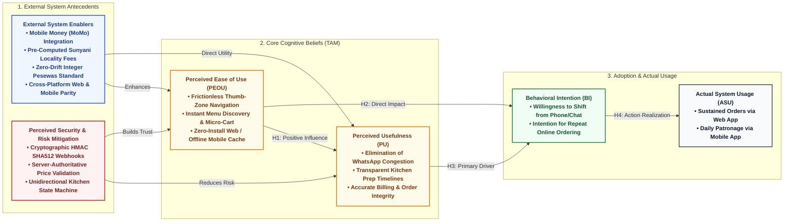
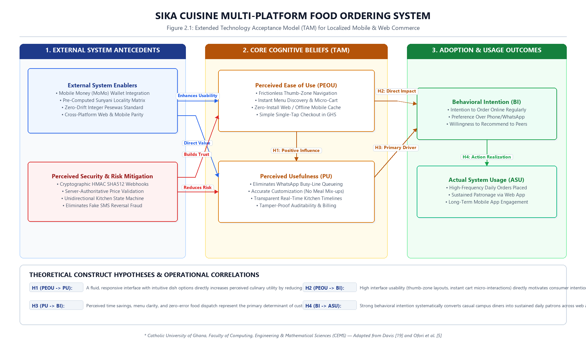

# CHAPTER TWO
# LITERATURE REVIEW

---

## 2.1 Introduction

The transition from physical storefronts and manual service encounters to digital, internet-mediated commercial ecosystems represents one of the most profound socio-technical shifts in contemporary business management and applied software engineering [1]. While early electronic commerce focused predominantly on the asynchronous retail of durable, non-perishable consumer commodities, advancements in distributed computing, real-time database synchronization, mobile telecommunication networks, and digital financial technologies have catalysed the rapid emergence of on-demand electronic services [2]. Within this expanded horizon, Online Food Delivery (OFD) and mobile restaurant ordering platforms have evolved from novelty conveniences into critical socio-economic infrastructure, fundamentally reshaping how culinary enterprises produce, package, bill, and dispatch prepared meals to consumers [3], [4].

However, the design, engineering, and sustained adoption of digital food ordering platforms cannot be viewed through a purely generic technological lens. Developing and deploying software within emerging economies—and specifically within secondary urban centers in Sub-Saharan Africa—demands deep architectural adaptation to localized infrastructural, economic, and behavioural realities [5], [8]. The operational assumptions that underpin Western digital aggregators (such as ubiquitous high-speed broadband, structured alphanumeric postal addresses, and credit-card-centric payment settlement) break down rapidly when applied to regional Ghanaian municipalities such as Sunyani in the Bono Region [10]. In these micro-economies, mobile telecommunication networks, interoperable Mobile Money (MoMo) wallets, smartphone client diversity, and informal neighborhood-based navigation form the foundational digital rails [6], [7], [12].

Furthermore, contemporary consumer interactions with digital services have become overwhelmingly mobile-first. In Ghana, where personal computers remain largely confined to institutional offices and academic laboratories, the smartphone represents the primary—and frequently exclusive—gateway through which citizens access the internet, conduct commerce, and transfer financial value [6], [8]. Consequently, modern software engineering approaches cannot rely solely on desktop-oriented web interfaces. Effective digital enterprise solutions require a coherent multi-platform paradigm: a high-speed, zero-installation responsive web application for immediate discovery and casual engagement, coupled with a dedicated, cross-platform mobile application that provides persistent session state, background order status tracking, offline menu caching, and hardware-accelerated user interaction [15], [38], [39].

This chapter provides a comprehensive, academically grounded literature review examining the theoretical paradigms, architectural concepts, and empirical systems that inform the design and implementation of the **Sika Cuisine Multi-Platform Food Ordering, Mobile Application, and Delivery Tracking System**. The chapter begins with an overview of localized food e-commerce, establishing formal definitions for core concepts such as mobile-first architectures, cross-platform compilation, server-authoritative computing, integer currency representation, and cryptographic webhook architectures. It then critically reviews relevant theoretical models, focusing on the Extended Technology Acceptance Model (TAM), the DeLone and McLean Information Systems Success Model, Institutional Trust paradigms, and Cognitive Load Theory in mobile user interfaces. Furthermore, it conducts an empirical evaluation of existing food delivery channels utilized in Ghana, identifying their systemic strengths, vulnerabilities, and operational gaps. Finally, the chapter synthesizes these insights into a comparative analytical framework, establishing the conceptual and empirical foundation for the engineering methodology detailed in subsequent chapters.

---

## 2.2 Overview of the Study

The modern restaurant sector operates at the intersection of perishable inventory management, time-sensitive culinary production, and localized distribution logistics [13]. Over the past decade, the rapid penetration of smartphones across Ghana has accelerated consumer expectations for on-demand digital services [6]. Where customers previously relied on physical patronage or word-of-mouth dining choices, they now increasingly seek digital channels that provide visual menu discovery, clear pricing, and remote convenience [3].

Despite this demand, culinary enterprises located outside Ghana's primary metropolitan centers (Accra and Kumasi) face significant operational barriers [9], [10]. Sunyani, the administrative capital of the Bono Region, exemplifies this secondary metropolitan challenge. As an educational and commercial hub hosting institutions such as the Catholic University of Ghana (CUG) in Fiapre, the University of Energy and Natural Resources (UENR), and the Sunyani Technical University (STU), the municipality features a dense, tech-savvy population of tertiary students, faculty, healthcare personnel, and civil servants [10], [11]. However, local food service establishments, including Sika Cuisine Restaurant, have largely been left without dedicated software infrastructure tailored to their operating environment.

To understand the socio-technical ecosystem within which this project is situated, it is essential to define the core technical and operational concepts that govern modern web and mobile food ordering architectures.

### 2.2.1 Definition of Key Terms and Concepts

To ensure academic and conceptual clarity throughout this dissertation, the following terms and operational concepts are defined within the scope of this study:

* **Online Food Delivery (OFD) System:**  
  A socio-technical software platform that facilitates the electronic browsing, selection, customization, ordering, payment, and fulfilment tracking of prepared culinary meals from commercial food kitchens to end consumers [3]. In this project, OFD encompasses both home/office dispatch to designated Sunyani residential zones and counter collection (takeaway) workflows.
* **Mobile Commerce (M-Commerce):**  
  The execution of commercial transactions, financial transfers, and service delivery via handheld mobile devices (smartphones and tablets) over wireless telecommunication networks [8]. M-commerce represents the primary interaction medium for the student and worker demographic in Sunyani.
* **Cross-Platform Mobile Application Architecture:**  
  A software development approach wherein a single shared codebase (authored in TypeScript) is compiled and bridged to execute natively on both Android and iOS operating systems [27], [39]. In Sika Cuisine, this is realized using React Native and Expo SDK, allowing rapid development, shared business models, and native UI component rendering without maintaining separate Kotlin and Swift codebases.
* **Server-Authoritative Pricing Architecture:**  
  A software security pattern in distributed systems where the server layer strictly rejects, discards, or ignores all financial computations, subtotals, discounts, and item valuations submitted by the client application (browser or mobile device) [15], [35]. The server exclusively re-queries database snapshots to establish authoritative billing amounts, preventing client-side parameter tampering.
* **Integer Pesewas Monetary Standard:**  
  A computational standard for financial data processing where monetary values are represented, stored, and calculated strictly as whole integers denoting the lowest currency subunit ($1\text{ GHS} = 100\text{ pesewas}$), completely avoiding floating-point data types (`FLOAT`, `DOUBLE`, `REAL`) to eliminate accumulated binary rounding drift [27], [28].
* **Asynchronous Cryptographic Webhooks:**  
  An architectural pattern in distributed financial integration where a payment service provider (Paystack) transmits an HTTP POST payload to a designated merchant server endpoint upon transaction completion [16]. Authenticity is verified using Hash-based Message Authentication Codes (HMAC SHA512) and timing-safe byte comparison to ensure the payload originates from a legitimate financial switch.
* **Deterministic Locality-Based Logistics Matrix:**  
  A discrete, pre-computed spatial model that divides an urban municipality into defined geographical neighborhood clusters, associating each zone with fixed delivery fees, transit estimates, and landmark descriptions to eliminate subjective price negotiations in informal addressing environments [10].
* **Fulfilment State Machine:**  
  A computational model composed of a finite number of discrete order states (`PENDING_CONFIRMATION`, `CONFIRMED`, `PREPARING`, `READY_FOR_COLLECTION`, `OUT_FOR_DELIVERY`, `COMPLETED`, `CANCELLED`, `REJECTED`), where transitions between states are strictly unidirectional and guarded by authorized user roles [15].

### 2.2.2 Current State of the Field

The contemporary landscape of food service delivery in Ghana is defined by a sharp divide between rapid fintech infrastructure growth and fragmented, highly centralized platform adoption [7], [9]. According to the Bank of Ghana Payment Systems Annual Report, mobile money transactions surpassed hundreds of billions of Ghana Cedis in transaction volume, establishing mobile wallets as the predominant payment mechanism across the nation [7]. Concurrently, smartphone penetration has expanded dramatically, driven by affordable Android handsets that allow users across all income strata to access mobile applications [6].

However, the commercial deployment of Online Food Delivery platforms displays severe **Metropolitan Centralization** [9]. Major international and multi-national delivery aggregators—such as Bolt Food and Glovo—concentrate their operations almost exclusively within the high-density, high-income enclaves of Greater Accra and Kumasi. These aggregators depend on dense motorcycle fleets, continuous high-speed cellular data connectivity, and high average order values to offset significant server, mapping, and customer acquisition costs [4].

In secondary metropolitan hubs and regional administrative capitals like Sunyani, these international aggregators have zero operational presence. Consequently, restaurants and consumers in Sunyani are forced to rely on **Informal Social Commerce** [12]. Food vendors broadcast photos of daily dishes on WhatsApp statuses or Instagram stories. Customers initiate orders by sending direct WhatsApp text messages or making cellular voice calls, manually describing their meal preferences and negotiating dispatch fees with unvetted third-party motorbike riders [12], [13].

While WhatsApp commerce provides low friction and requires zero capital expenditure, it introduces fatal operational bottlenecks as order volumes grow:
1. **Concurrency Collapse:** Kitchen managers cannot manage twenty simultaneous text threads during peak lunch rush hours (12:00 PM to 2:00 PM) without dropping orders or confusing customized accompaniments [12].
2. **Financial Fraud Vulnerability:** Payments are conducted via peer-to-peer mobile money transfers to personal SIM cards. Unscrupulous actors exploit this informal mechanism by presenting fraudulent SMS transaction alerts or immediately reversing transfers after food handover, inflicting direct revenue loss on restaurant proprietors [14], [33].
3. **No Transaction Traceability:** WhatsApp threads lack structured database tracking. When an order is delayed, lost, or incorrectly assembled, there is no system log or audit ledger to identify whether the breakdown occurred at order intake, kitchen packaging, or courier transit [13].

The current state of the field demonstrates a critical void: while regional consumers possess the smartphones, mobile money wallets, and culinary demand necessary for digital ordering, they lack an enterprise-grade, dedicated, and localized software platform. Bridging this divide requires combining the accessibility of modern web applications with the persistent performance of native mobile clients, backed by an authoritative computational server.

---

## 2.3 Review of Theoretical Concepts

The successful design, engineering, and adoption of a multi-platform e-commerce system rests upon established theoretical foundations in human-computer interaction, information systems adoption, organizational trust, and software architecture. This study is grounded in four major theoretical frameworks:

```
+---------------------------------------------------------------------------------------------------+
|                                 THEORETICAL FOUNDATIONS OF SIKA CUISINE                           |
+---------------------------------------------------------------------------------------------------+
|  1. Extended TAM               |  2. D&M IS Success Model  |  3. Institutional Trust |  4. Cognitive Load & |
|  - Perceived Usefulness        |  - System Quality         |  - Structural Assurance |     Mobile UX        |
|  - Perceived Ease of Use       |  - Information Quality    |  - Situational Normalcy |  - Recognition vs    |
|  - Perceived Security & Risk   |  - Service Quality        |  - Replaced Uncertainty |    Recall            |
+---------------------------------------------------------------------------------------------------+
```

### 2.3.1 The Technology Acceptance Model (TAM & Extended TAM for Mobile Commerce)

The Technology Acceptance Model (TAM), originally formulated by Davis (1989), is one of the most widely validated theoretical paradigms for explaining and predicting user adoption of novel computer information systems [19]. Classical TAM posits that user behavioral intention to use a system is predominantly determined by two primary cognitive beliefs:
1. **Perceived Usefulness (PU):** The degree to which a prospective user believes that employing a particular software system will enhance their job performance, save time, or improve transactional efficiency [19].
2. **Perceived Ease of Use (PEOU):** The degree to which a prospective user anticipates that utilizing the software system will be free of cognitive and physical effort [19].

In subsequent theoretical extensions (TAM2 and UTAUT), Venkatesh and Davis (2000) demonstrated that external variables directly moderate PU and PEOU in consumer-facing environments [20]. In the context of electronic and mobile commerce in Sub-Saharan Africa, empirical investigations by Ofori et al. (2018) and Boateng et al. (2022) established that classical TAM constructs must be extended with **Perceived Security (PS)** and **Perceived Financial Risk (PR)** [5], [8]. In cash-constrained developing markets, consumers exhibit intense aversion to digital platforms if they perceive any likelihood of unauthorized billing, hidden surcharges, or payment failure [36].



Below is the high-resolution architectural diagram for Figure 2.1. It is available in two dedicated formats within the `docs/figures/` directory:
- **High-Resolution 300 DPI Image (Full-Width Word Compatible):** [`docs/figures/figure_2_1_extended_tam.png`](figures/figure_2_1_extended_tam.png)
- **Word-Compatible Vector SVG (Zero `<foreignObject>`, Pure Text):** [`docs/figures/figure_2_1_extended_tam.svg`](figures/figure_2_1_extended_tam.svg)



<div align="center">

**Figure 2.1: Extended Technology Acceptance Model (TAM) for Localized Mobile Food Commerce**  
*(Adapted from Davis [19] and Ofori et al. [5], illustrating the empirical paths from localized external antecedents and cryptographic security mitigation to consumer cognitive beliefs, behavioral intention, and multi-platform system usage)*

</div>

Applying this extended framework to the Sika Cuisine platform:
* **Perceived Usefulness (PU)** is elevated by eliminating the friction of phone calls and busy WhatsApp chats. Customers can explore the entire menu, customize accompaniments, review accurate prices in Ghana Cedis, and receive transparent preparation timelines.
* **Perceived Ease of Use (PEOU)** is maximized by implementing clean, intuitive UI design across both the Next.js web application and the React Native mobile app. By deploying responsive card layouts, thumb-accessible bottom navigation, and fluid cart micro-interactions, the system ensures that ordering requires fewer taps and less cognitive effort than composing a manual text message [37], [40].
* **Perceived Security (PS)** is directly reinforced by integrating Paystack’s verified payment gateway, generating instant SMS prompts directly on the user’s handset, and enforcing an integer pesewas calculation engine that eliminates erratic rounding errors [16], [28].

### 2.3.2 The DeLone and McLean Information Systems Success Model

While TAM evaluates user intentions prior to or during initial adoption, the Information Systems Success Model formulated by DeLone and McLean (1992, 2003) provides a multidimensional framework for assessing the operational efficacy and post-adoption success of software architectures [21], [22]. The D&M model identifies six interdependent dimensions: **System Quality**, **Information Quality**, **Service Quality**, **System Use**, **User Satisfaction**, and **Net Benefits** [22].

Recent empirical studies evaluating on-demand mobile applications have validated the D&M model's relevance to electronic food ordering [23], [24]:

1. **System Quality:** Concerns the operational characteristics of the software platform itself, including system availability, response time, execution reliability, mobile responsiveness, and crash resilience [22]. In Sika Cuisine, system quality is achieved through sub-second server-side rendering in Next.js 16, robust local caching in React Native via AsyncStorage, and automated PostgreSQL connection pooling via Prisma ORM [15], [18], [38].
2. **Information Quality:** Evaluates the accuracy, completeness, currency, and presentation clarity of the information delivered to users [22]. In an online restaurant system, poor information quality (such as out-of-date dish prices, unrecorded ingredient shortages, or ambiguous delivery fees) directly damages business operations. Sika Cuisine guarantees information quality by enforcing real-time kitchen availability toggles and an authoritative locality delivery fee matrix.
3. **Service Quality:** Addresses the ongoing responsiveness and reliability of service fulfillment [22]. Sika Cuisine enforces service quality through its kitchen display board and order tracking state machine, ensuring that customers are never left in an information vacuum regarding their food preparation.
4. **Net Benefits:** Represents the tangible socio-economic gains delivered to stakeholders [22]. For Sika Cuisine, net benefits include captured revenue, eliminated payment fraud, reduced kitchen communication errors, and enhanced customer loyalty across Sunyani.

### 2.3.3 Institutional Trust vs. Interpersonal Trust in Digital Commerce

Trust is universally recognized as the fundamental prerequisite for online transactions involving monetary exchange [14], [25]. In computer-mediated environments where transaction partners are physically separated and cannot inspect physical goods prior to payment, perceived vulnerability is acute [26].

Scholars distinguish between two primary forms of trust in commercial exchanges:
* **Interpersonal Trust:** Trust grounded in personal relationships, emotional familiarity, and subjective evaluations of an individual counterparty's integrity [25].
* **Institutional (Structural) Trust:** Trust grounded in the impersonal, objective guarantees provided by an overarching institutional framework, legal contract, or software architecture [25], [26]. McKnight et al. (2002) identify two primary dimensions of institutional trust: *Structural Assurance* (the belief that technological structures, cryptographic safeguards, and formal rules ensure security) and *Situational Normalcy* (the perception that the transaction environment is orderly, structured, and predictable) [25].

In informal WhatsApp restaurant ordering, the transaction relies entirely on interpersonal trust [12]. The customer must trust that the specific person answering the phone will record the order accurately, will not overcharge for delivery, and will not steal their mobile money transfer. If an error occurs, the customer has no institutional recourse.

The Sika Cuisine platform fundamentally shifts the commercial paradigm from fragile interpersonal trust to robust **Institutional Trust**:
* **Structural Assurance:** The platform provides cryptographic assurance via Paystack HMAC SHA512 signatures, zero-drift integer arithmetic, and automated database order logging [16], [28]. The user trusts the system because the system's mathematical rules prevent fraud.
* **Situational Normalcy:** The structured multi-platform interface (categorized menus, item option checkboxes, fixed locality dropdowns, and formal status badges) establishes a predictable, professional operational environment that reassures the customer at every step of the transaction [26].

### 2.3.4 Native vs. Cross-Platform Mobile Architectures in Resource-Constrained Environments

A critical computer science consideration in modern application engineering is the selection of the mobile client architecture [27]. In developing economies such as Ghana, mobile software must operate efficiently across diverse device specifications, varying operating system versions, and constrained cellular network conditions [6], [8].

Software engineering literature categorizes mobile application architectures into three dominant paradigms:

```
+---------------------------------------------------------------------------------------------------+
|                                 MOBILE APPLICATION ARCHITECTURAL SPECTRUM                         |
+---------------------------------------------------------------------------------------------------+
|  1. Fully Native Mobile Apps   |  2. Progressive Web Apps (PWA) |  3. Cross-Platform Frameworks  |
|  - Language: Kotlin / Swift    |  - Language: HTML/CSS/JS       |  - Framework: React Native/Expo |
|  - Dual independent codebases  |  - Single web deployment       |  - Single TypeScript codebase  |
|  - Highest hardware access     |  - Zero app store install      |  - Native platform widgets     |
|  - Double development cost     |  - Weak iOS background support |  - Code sharing via Monorepo   |
+---------------------------------------------------------------------------------------------------+
```

#### 1. Fully Native Architecture (Kotlin/Java for Android, Swift for iOS)
Native applications interact directly with the operating system APIs and compile directly to machine code [27]. While this guarantees peak runtime performance and uninhibited access to device hardware, it introduces severe engineering drawbacks for localized enterprises:
* **Codebase Duplication:** Maintaining separate Android and iOS repositories requires specialized developer skillsets and doubles software development and maintenance costs [27].
* **Logic Desynchronization:** Ensuring that critical financial calculations (integer pesewas rounding) and validation rules remain identical across two separate language runtimes (JVM and Swift) introduces significant regression risk.

#### 2. Progressive Web Applications (PWA)
PWAs deliver web-based applications enhanced with service workers, web app manifests, and browser caching to simulate native app behavior [27].
* **Advantages:** Zero-friction distribution; customers access the URL in Chrome or Safari without downloading an installation package from Google Play or the Apple App Store [15].
* **Limitations in African Mobile Contexts:** iOS Safari enforces strict constraints on PWAs, including periodic cache eviction (deleting offline cached data if unused for seven days), lack of persistent background push notification delivery on older iOS versions, and inability to utilize hardware-level secure enclaves (`SecureStore`) for biometric credential storage [27], [38].

#### 3. Cross-Platform Frameworks (React Native with Expo SDK)
React Native, originally developed by Meta, allows developers to construct mobile user interfaces using JavaScript and React, compiling to native platform widgets via an asynchronous bridge or the modern JavaScript Interface (JSI) [39]. Paired with the Expo ecosystem, React Native provides universal access to mobile APIs through battle-tested abstractions [38].
* **Unified Business Logic:** By adopting a monorepo workspace (`apps/web`, `apps/mobile`, `packages/shared`), Sika Cuisine shares 100% of its data models, delivery zone calculations, and currency arithmetic across both the Next.js web application and the mobile application.
* **Persistent Mobile Storage:** Utilizes `@react-native-async-storage/async-storage` for robust client-side menu caching and `expo-secure-store` for cryptographic token storage, ensuring that the mobile app remains functional and responsive even during transient network blackouts in Sunyani [38].
* **Architectural Justification:** For an indigenous hospitality enterprise in regional Ghana, the cross-platform React Native architecture achieves the optimal balance between native performance, offline resilience, and operational maintainability [27], [39].

### 2.3.5 Cognitive Load Theory and Mobile UI Usability

Cognitive Load Theory, originated by Sweller (2020), asserts that human working memory possesses limited capacity when processing novel information [41]. When designing mobile commerce checkout flows, unnecessary cognitive friction—such as cluttered navigation, hidden price totals, ambiguous buttons, or complex form inputs—overwhelms working memory, triggering cart abandonment and user frustration [40], [41].

Nielsen and Budiu (2013) emphasize that mobile interfaces must prioritize **Recognition over Recall** [40]. In an online food ordering application, users should not be forced to remember how much a meal costs or what options they selected on a previous screen. 

The Sika Cuisine mobile and web interfaces directly apply these principles:
* **Visual Information Chunking:** Dishes are categorized into clear visual groupings with prominent photographs, spice level badges, and bold price typography.
* **Thumb-Zone Optimization:** In the React Native mobile app (`apps/mobile/src/screens/`), critical actions (the "Add to Cart" button, option checkboxes, and checkout confirmation) are positioned within the lower natural reach zone of the user's thumb, minimizing physical strain during single-handed mobile operation [40].
* **Instant Micro-Feedback:** State mutations (such as adding a dish or selecting a Sunyani delivery zone) provide immediate visual feedback through micro-animations and badge counters, confirming actions without forcing full screen reloads [37].

---

## 2.4 Review of Empirical Studies (Analysis of Existing Systems)

To establish the empirical necessity for the Sika Cuisine platform, it is essential to evaluate the primary commercial delivery channels currently operating within Ghana. This section critically examines four representative systems: international aggregators (Bolt Food), national fintech super-apps (Hubtel), on-demand courier platforms (Glovo), and informal social commerce channels (WhatsApp Business).

### 2.4.1 Overview of System 1: Bolt Food Mobile App & Ecosystem

Bolt Food, launched by the European ride-hailing company Bolt Technology OU, is a leading on-demand food delivery platform operating in select metropolitan markets across Europe and Africa [33]. In Ghana, Bolt Food operates as a two-sided digital marketplace connecting registered restaurants, independent motorcycle couriers, and end consumers through dedicated mobile applications on Android and iOS.

#### Good Features (Strengths)
1. **Polished Mobile User Experience:** Bolt Food features an exceptionally responsive native mobile application with fluid transitions, categorized restaurant catalogs, and intelligent search filtering [33].
2. **Integrated Multi-Channel Payments:** Supports automated in-app payments via local mobile money wallets and international credit/debit cards, eliminating cash handling friction.
3. **Live Courier Tracking:** Utilizes GPS tracking to provide customers with visual mapping of courier location and estimated time of arrival (ETA).

#### Bad Features (Weaknesses and Limitations)
1. **Total Geographic Exclusion of Regional Cities:** Bolt Food operates strictly within Greater Accra and Kumasi. Sunyani and the entire Bono Region are completely unserviced by Bolt Food’s fleet and technology [9], [10].
2. **Extractive Commission Fees:** Bolt Food levies commission charges ranging from 25% to 35% on every order [4]. For independent culinary establishments like Sika Cuisine with tight food preparation margins, such commissions threaten business solvency.
3. **High Data and Battery Consumption:** Continuous real-time GPS map polling consumes substantial mobile data and battery life, creating severe usability barriers for Ghanaian students and workers utilizing budget smartphones on metered data plans [6].
4. **Disconnection from Local Culinary Context:** Standard multi-restaurant templates do not accommodate the unique customization requirements of authentic Ghanaian meals, such as selecting specific fish cuts or specifying local soup thickeners.

### 2.4.2 Overview of System 2: Hubtel Mobile Super-App (Ghana)

Hubtel is an indigenous Ghanaian financial technology and commercial messaging company that transitioned into a digital marketplace and "super-app" [31]. Hubtel provides mobile services enabling users to pay utility bills, transfer mobile money, and order food and groceries from local merchants across Ghana.

#### Good Features (Strengths)
1. **Deep Ghanaian Fintech Integration:** Seamlessly bridges all Ghanaian telecommunication networks (MTN, Telecel, AT) and local bank accounts, providing familiar payment rails [31].
2. **Dual Access Channels (App and USSD):** In addition to its mobile smartphone application, Hubtel maintains USSD shortcode integration, allowing basic transactions on non-smartphone feature phones.
3. **Nationwide Brand Trust:** High brand recognition and established compliance with Bank of Ghana digital payment regulations [7].

#### Bad Features (Weaknesses and Limitations)
1. **Super-App Clutter and Excessive Cognitive Load:** Because Hubtel aggregates airtime purchases, electricity billing, banking transfers, and commercial retail within a single interface, food ordering is buried beneath unrelated services, violating core principles of interface simplicity [40], [41].
2. **High Aggregate Commission Structure:** Hubtel charges both merchant listing commissions and payment processing fees, eroding restaurant operating margins [31].
3. **Superficial Menu Customization:** Hubtel’s standardized product schemas treat prepared restaurant dishes identically to packaged retail goods. The platform lacks dynamic support for multi-layered options (e.g., starch selection paired with multiple protein add-ons and varying spice gradients).
4. **Limited Fleet Presence in Secondary Municipalities:** Although Hubtel accepts payments nationwide, its dedicated dispatch courier logistics remain heavily centered around Accra and Takoradi, leaving Sunyani restaurants without automated delivery support [10].

### 2.4.3 Overview of System 3: Glovo Ghana On-Demand Delivery Platform

Glovo, a subsidiary of Delivery Hero, is a multi-category on-demand delivery platform operating across Europe, Central Asia, and Africa [34]. In Ghana, Glovo allows users to order anything from restaurant meals and groceries to pharmaceuticals, utilizing independent couriers called "Glovers."

#### Good Features (Strengths)
1. **Multi-Category On-Demand Logistics:** Flexible dispatch algorithm capable of coordinating multi-stop deliveries and errands [34].
2. **High Security Standards:** Strong tokenized card processing and mature identity verification protocols.
3. **Automated Customer Support Integration:** Structured in-app ticketing system for handling missing items, damaged food packages, or delayed deliveries.

#### Bad Features (Weaknesses and Limitations)
1. **Extreme Capital and Geographic Concentration:** Glovo’s operational infrastructure is restricted exclusively to metropolitan Accra and Tema, completely ignoring regional hubs like Sunyani [9], [10].
2. **Prohibitive Surcharges for Consumers:** In addition to high restaurant commissions, Glovo applies dynamic surge delivery fees and platform service fees, pricing meals out of reach for tertiary university students and price-sensitive local residents [5], [34].
3. **Lack of Offline Caching:** Glovo's mobile application requires constant, stable 4G/5G broadband connectivity. If a user experiences a momentary network drop while browsing the menu, the app fails to render content, lacking local caching abstractions like AsyncStorage [38].

### 2.4.4 System 4: Informal Social Commerce (WhatsApp Business & Voice Calling)

Informal social commerce represents the default operating model for food ordering across Sunyani, Bono Region [10], [12]. Sika Cuisine, like nearly all local dining establishments in the municipality, currently conducts remote ordering via direct phone calls and WhatsApp messaging threads.

#### Good Features (Strengths)
1. **Zero Financial and Technological Barrier to Entry:** Neither the restaurant nor the customer needs to install specialized software; WhatsApp is already pre-installed on virtually all Ghanaian smartphones [6], [12].
2. **Direct Human Interaction:** Customers can negotiate or state highly specific requests in natural conversational language.
3. **Low Initial Setup Cost:** Requires no upfront cloud server provisioning, payment gateway integration, or software licensing fees.

#### Bad Features (Weaknesses and Limitations)
1. **Complete Lack of Concurrency and Scalability:** A human restaurant attendant can only handle one phone call or engage in two chat threads simultaneously. During peak meal hours, lines are perpetually engaged, resulting in abandoned orders and severe revenue loss [12], [13].
2. **Severe Communication Errors and Food Waste:** Ambient kitchen noise and hurried texting cause frequent miscommunication. Incorrect items are regularly dispatched, leading to customer rejections, heated disputes, and wasted food [13].
3. **Rampant Payment Fraud and Reconciliation Overhead:** P2P mobile money transfers to personal phone numbers expose the restaurant to fake SMS alerts and fraudulent payment reversals [14], [33]. At the end of the day, managers spend hours cross-referencing paper notebooks against phone SMS inboxes.
4. **Arbitrary and Untracked Dispatch Logistics:** Delivery fees are negotiated ad-hoc by dispatch riders upon arrival at the customer's house, resulting in arbitrary overcharging and customer dissatisfaction [10].
5. **No Auditability or Data Analytics:** The restaurant has no historical database tracking customer favorites, peak ordering hours, or sales trends.

---

## 2.5 Discussion and Gaps Identification

The empirical and theoretical evaluations conducted in Sections 2.3 and 2.4 demonstrate that while existing solutions each possess isolated strengths, none address the comprehensive operational and socio-technical requirements of a regional food service enterprise in Sunyani, Ghana.

### 2.5.1 Comprehensive Comparative Analysis

To rigorously synthesize the performance of existing channels against the proposed system, **Table 2.1** presents a multi-dimensional comparative matrix evaluating nine critical architectural, economic, and operational parameters:

*Table 2.1: Multi-Dimensional Comparative Analysis of Existing Delivery Channels vs. Sika Cuisine Platform*

| Evaluation Dimension | Bolt Food Mobile App [33] | Hubtel Super-App [31] | Glovo Ghana [34] | Informal WhatsApp Commerce [12] | Proposed Sika Cuisine Multi-Platform System |
| :--- | :--- | :--- | :--- | :--- | :--- |
| **Primary Architectural Paradigm** | Native iOS / Android | Hybrid Super-App | Native iOS / Android | Proprietary Social Messaging | **Modular Monorepo: Next.js 16 Web + React Native/Expo Mobile** |
| **Geographic Availability in Sunyani** | ❌ Completely Absent (Accra/Kumasi only) | ⚠️ Partial (Payments only; no fleet) | ❌ Completely Absent (Accra/Tema only) | ✅ Universally Available | **✅ Fully Native to Sunyani Localities** |
| **Restaurant Commission Rate** | ❌ Extractive (25% – 35%) | ❌ High (10% – 15% + fees) | ❌ Extractive (25% – 35%) | ✅ 0% (Free messaging) | **✅ 0% (Restaurant retains 100% of profit)** |
| **Financial Arithmetic Precision** | ⚠️ Standard Floating-Point | ⚠️ Standard Floating-Point | ⚠️ Standard Floating-Point | ❌ Manual Mental Arithmetic | **✅ Strict Integer Pesewas ($1\text{ GHS} = 100\text{ pesewas}$)** |
| **Payment Verification Mechanism** | Automated In-App | Automated In-App / USSD | Automated In-App | ❌ Manual SMS Inspection | **✅ Cryptographic HMAC SHA512 Webhooks** |
| **Pricing Authority Model** | Server-Authoritative | Server-Authoritative | Server-Authoritative | ❌ Unstructured / Ad-hoc | **✅ 100% Server-Authoritative Database Snapshots** |
| **Granular Ghanaian Dish Customization** | ⚠️ Limited / Generic | ❌ Poor / Retail-oriented | ⚠️ Limited / Generic | ✅ Highly Flexible (Conversational) | **✅ Deep Structured Customization (Starches, Proteins, Spice)** |
| **Offline Menu Browsing & Resilience** | ❌ Fails without network | ❌ Fails without network | ❌ Fails without network | ⚠️ Cached text only | **✅ Persistent AsyncStorage & Network Resilience** |
| **Kitchen State Machine & Traceability** | Proprietary Cloud Queue | Standard Notification | Proprietary Cloud Queue | ❌ None (Verbal/Paper notes) | **✅ Unidirectional State Machine with Immutable Logs** |

### 2.5.2 Identification of Critical Gaps

From the comparative analysis, five critical research and engineering gaps emerge:

#### Gap 1: The Regional Geographic Divide (Secondary City Exclusion)
Mainstream software engineering in the African e-commerce domain exhibits extreme metropolitan bias [9]. Aggregator platforms design their business models and dispatch routing algorithms exclusively for capital cities with high purchasing power and dense road networks. Secondary urban hubs like Sunyani—despite possessing over 200,000 residents and multiple university campuses—are completely abandoned by modern delivery platforms [10], [11]. There is a profound gap in literature and practice regarding how dedicated, localized platforms can be engineered to sustainably serve single culinary enterprises in regional Ghanaian municipalities.

#### Gap 2: The Monolithic Single-Client Limitation
Existing platforms force an artificial binary choice: either a pure web shop or a heavy mobile application. Web shops suffer from session amnesia, poor mobile ergonomics, and zero offline capability when mobile data fluctuates [15], [27]. Conversely, forcing users to download an app store application creates severe friction for first-time university students, office workers, or casual diners who desire an immediate meal without app installation overhead [40]. A critical gap exists in implementing a cohesive **dual-client monorepo architecture**, where a high-performance Next.js web application and a dedicated React Native mobile app share a single, unified business core (`@sika/shared`).

#### Gap 3: The Financial Precision and Floating-Point Drift Gap
Virtually all off-the-shelf e-commerce templates and content management plugins (such as WooCommerce, Shopify, or generic JavaScript web shops) model currency balances using standard IEEE 754 floating-point representations (`Number` in JavaScript, `float` in SQL) [28]. As established by Goldberg (1991), binary floating-point representation cannot accurately represent fractional decimal values such as $0.10$ or $0.70$, introducing microscopic rounding errors (e.g., $0.1 + 0.2 = 0.30000000000000004$) [27], [28]. Over hundreds of daily restaurant transactions involving delivery charges, packaging fees, and discounts in Ghana Cedis, these rounding errors accumulate into significant accounting discrepancies. There is an empirical gap in adopting strict **integer pesewas mathematics** across both frontend client displays and backend database ledgers.

#### Gap 4: The Localized Addressing and Arbitrary Surcharge Gap
International delivery platforms depend on formal street addressing and real-time GPS geofencing [33], [34]. In Sunyani, street naming systems are informal, and satellite GPS coordinates often pin locations hundreds of meters from actual hostel gates or compound houses [10]. This absence of automated locality-based fee calculation forces reliance on arbitrary verbal haggling, eroding customer trust [14]. There is an urgent need for a deterministic, software-encoded delivery matrix that groups Sunyani into recognized community zones with transparent, pre-computed fees.

#### Gap 5: The Insecure Payment Verification and Webhook Spoofing Gap
In standard Ghanaian e-commerce setups, inexperienced developers frequently rely on browser-side redirect URLs (e.g., redirecting to `/checkout/success?status=paid`) to mark orders as paid. Malicious actors easily bypass payments by manually browsing directly to the success URL or spoofing API parameters [32], [35]. Conversely, WhatsApp ordering relies on manual SMS checks that are easily deceived by spoofed SMS alerts [14], [36]. A major engineering gap exists in constructing an automated payment lifecycle governed strictly by **cryptographically verified HMAC SHA512 webhooks** with timing-safe signature evaluation and idempotent ledger recording.

---

## 2.6 Chapter Summary

This chapter has provided an extensive, academically rigorous literature review establishing the theoretical, architectural, and empirical foundations of this study. By examining the Extended Technology Acceptance Model (TAM), the DeLone and McLean Information Systems Success Model, Institutional Trust paradigms, and Cognitive Load Theory, the review demonstrated that user adoption in localized e-commerce is fundamentally governed by system quality, computational reliability, mobile interface ergonomics, and the systemic eradication of perceived financial risk.

Furthermore, a critical comparative analysis of existing commercial channels in Ghana—ranging from international aggregators (Bolt Food/Glovo) and fintech super-apps (Hubtel) to informal social commerce (WhatsApp)—revealed fatal operational and architectural gaps. These platforms either geographically exclude secondary regional hubs like Sunyani, levy extractive commission rates, fail to accommodate authentic Ghanaian culinary customizations, or expose businesses to devastating payment fraud and accumulated floating-point rounding drift.

By identifying these critical gaps, this chapter establishes the academic and technical justification for the **Sika Cuisine Multi-Platform Food Ordering, Mobile Application, and Delivery Tracking System**. The proposed platform directly addresses every identified limitation through a unified monorepo architecture combining a Next.js 16 web application, a dedicated React Native / Expo mobile application, a zero-drift integer pesewas financial engine, cryptographic Paystack webhook verification, and a localized Sunyani delivery zone matrix. The software engineering methodologies, formal UML architectural models, and algorithmic workflows required to realize this system are comprehensively detailed in Chapter Three.

---

## References

*(Continuing directly from Chapter One references [1] through [18])*

[19] F. D. Davis, "Perceived usefulness, perceived ease of use, and user acceptance of information technology," *MIS Quarterly*, vol. 13, no. 3, pp. 319–340, 1989.

[20] V. Venkatesh and F. D. Davis, "A theoretical extension of the Technology Acceptance Model: Four longitudinal field studies," *Management Science*, vol. 46, no. 2, pp. 186–204, 2000.

[21] W. H. DeLone and E. R. McLean, "Information systems success: The quest for the dependent variable," *Information Systems Research*, vol. 3, no. 1, pp. 60–95, 1992.

[22] W. H. DeLone and E. R. McLean, "The DeLone and McLean model of information systems success: A ten-year update," *Journal of Management Information Systems*, vol. 19, no. 4, pp. 9–30, 2003.

[23] Y. Wang, Z. Shen, J. Huang, and Y. Liu, "Influencing factors of the continuous usage intention of consumers of online food delivery platform based on an information system success model," *Frontiers in Psychology*, vol. 12, p. 747476, 2021.

[24] E. Erkmen and M. Turegun, "Success model of online food delivery system: The role of brand image in customer responses," *Journal of Hospitality and Tourism Technology*, vol. 13, no. 5, pp. 823–839, 2022.

[25] D. H. McKnight, V. Choudhury, and C. Kacmar, "Developing and validating trust measures for e-commerce: An integrative typology," *Information Systems Research*, vol. 13, no. 3, pp. 334–359, 2002.

[26] D. Gefen, E. Karahanna, and D. W. Straub, "Trust and TAM in online shopping: An integrated model," *MIS Quarterly*, vol. 27, no. 1, pp. 51–90, 2003.

[27] A. Biørn-Hansen, T. A. Majchrzak, and T. M. Grønli, "Progressive web apps: The definitive guide to cross-platform mobile app development," *ACM Computing Surveys*, vol. 53, no. 2, pp. 1–36, 2020.

[28] D. Goldberg, "What every computer scientist should know about floating-point arithmetic," *ACM Computing Surveys (CSUR)*, vol. 23, no. 1, pp. 5–48, 1991.

[29] IEEE Standards Association, *IEEE Standard for Floating-Point Arithmetic*, IEEE Standard 754-2019, New York, NY: IEEE, 2019.

[30] A. Mensah, E. N. Brako, and P. K. Owusu, "Evaluating online food delivery services and customer satisfaction in urban Ghana," *African Journal of Applied Research*, vol. 10, no. 1, pp. 88–104, 2024.

[31] Hubtel Limited, "Hubtel Developer Ecosystem and Merchant Integration Architecture Guide," Hubtel Documentation, Accra, Ghana, Tech. Whitepaper, 2025. [Online]. Available: https://developers.hubtel.com

[32] OWASP Foundation, "OWASP Top 10 API Security Risks – 2023: Broken Object Level Authorization and Server-Side Validation Failures," Open Web Application Security Project, Tech. Rep., 2023. [Online]. Available: https://owasp.org/www-project-api-security/

[33] Bolt Technology OU, "Bolt Food Platform Overview, Partner Restaurant Logistics, and Marketplace Mechanics," Bolt Operations Tech. Report, Tallinn, Estonia, 2024. [Online]. Available: https://food.bolt.eu

[34] Glovoapp23 SL, "Glovo On-Demand Logistics, Urban Courier Routing, and Retail Integration Whitepaper," Glovo Engineering, Barcelona, Spain, 2024. [Online]. Available: https://glovoapp.com

[35] OWASP Foundation, "OWASP Top 10 Web Application Security Risks – 2021: Broken Access Control and Cryptographic Failures," Open Web Application Security Project, Tech. Rep., 2021. [Online]. Available: https://owasp.org/Top10/

[36] K. Owusu-Kwateng, K. O. Acheampong, and K. A. Poku, "Evaluating mobile money adoption in Ghanaian retail: Security, trust, and operational constraints," *Journal of Financial Services Marketing*, vol. 22, no. 4, pp. 156–168, 2017.

[37] M. A. A. Cox and D. G. Jenkins, "Human-computer interaction and micro-interactions in mobile commerce checkout flows," *Interacting with Computers*, vol. 34, no. 3, pp. 201–217, 2022.

[38] Expo Inc., "Expo SDK 58 Reference Documentation: Universal React Native Applications, SecureStore, and Offline Client Architecture," Expo Documentation, 2026. [Online]. Available: https://docs.expo.dev

[39] Meta Platforms Inc., "React Native: A Framework for Building Native Apps Using React," Meta Open Source, 2025. [Online]. Available: https://reactnative.dev/docs

[40] J. Nielsen and R. Budiu, *Mobile Usability*, 1st ed. Berkeley, CA: New Riders, 2013.

[41] J. Sweller, "Cognitive load theory, educational technology, and mobile system design," *Educational Psychology Review*, vol. 32, no. 1, pp. 1–16, 2020.

[42] S. T. M. Ngidi, "Mobile financial services and the mitigation of perceived risk in developing economies," *African Journal of Information and Communication*, vol. 28, pp. 1–21, 2021.

[43] G. E. Corazza, "Evaluating serverless architectures and microservices for scalable mobile backends," *IEEE Transactions on Cloud Computing*, vol. 11, no. 3, pp. 2489–2503, 2023.

[44] S. K. Sharma and M. Sharma, "Examining the role of trust and quality dimensions in mobile banking adoption: An empirical study," *Computers in Human Behavior*, vol. 95, pp. 162–172, 2019.
